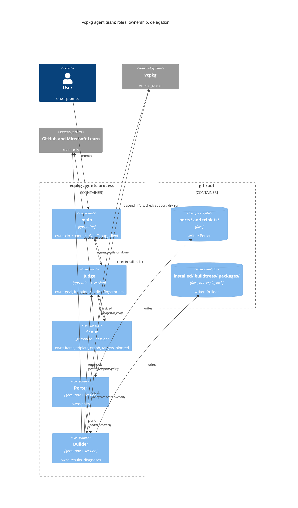
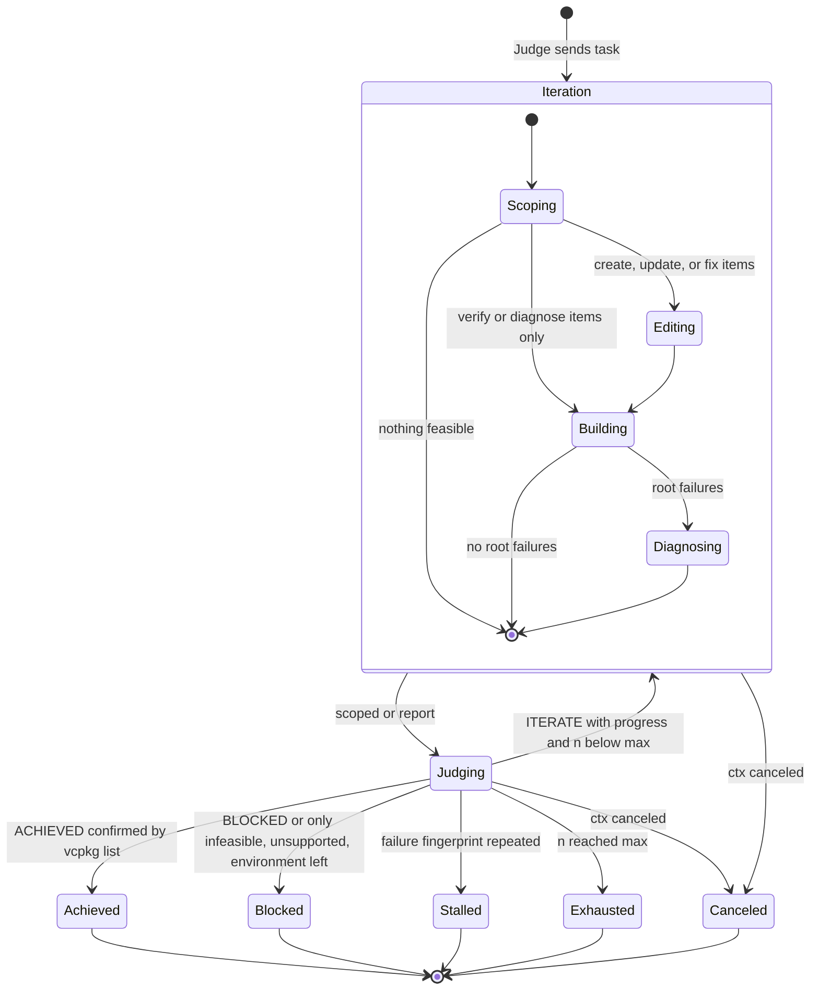
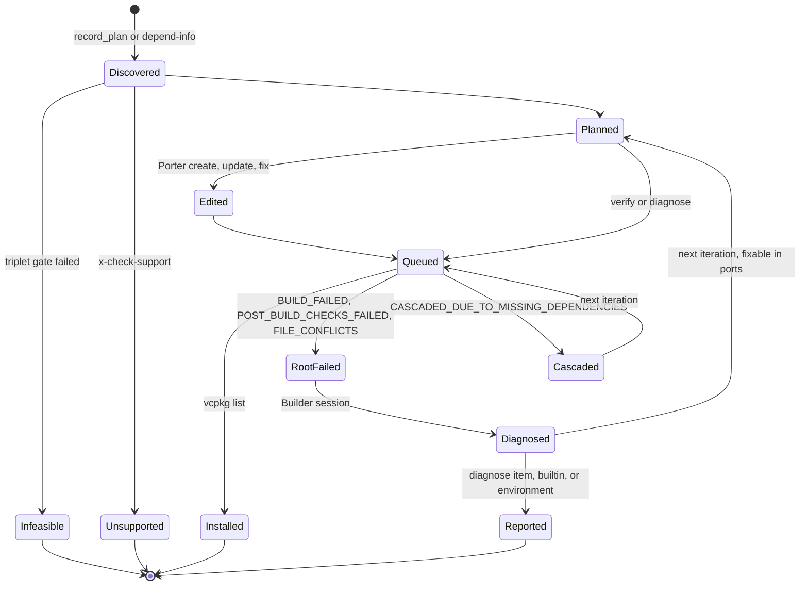
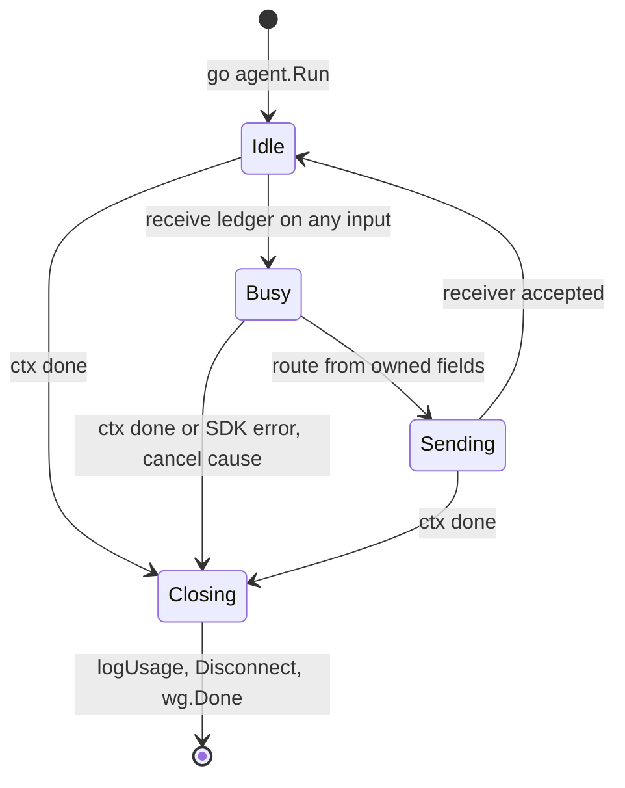
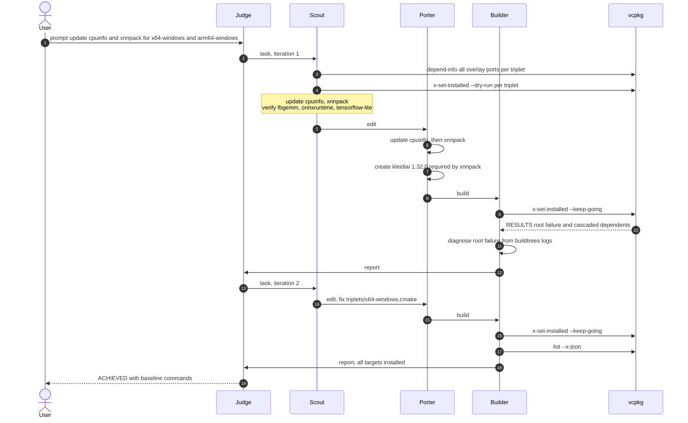
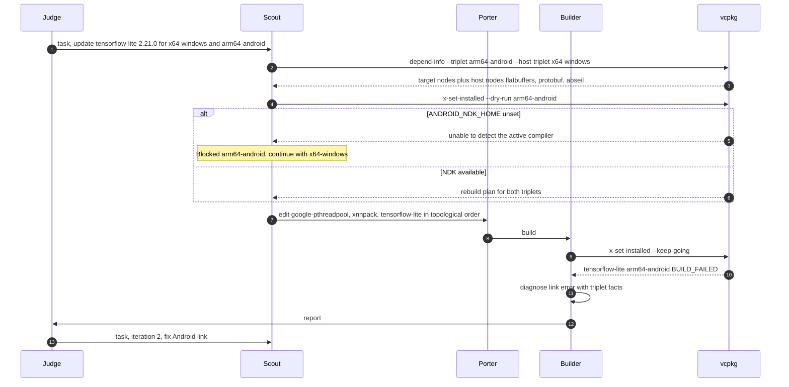
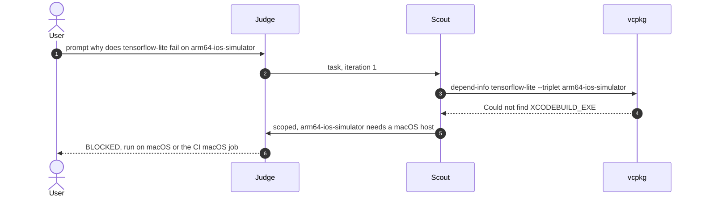

# vcpkg agent team design v2 (pending approval)

## Status and sources

- Status: design only, awaiting user approval. No repository file has changed.
- Request: "We will Implement 4 workflows (create, update, diagnose, troubleshoot) in vcpkg-agents.go ... Team of small agents will cooperate ... goroutine & channel based communicating sequential process patterns ... each goroutine owns a session, handles messages from multiple in/out channels. Design first. Do not go without approval. Place `Judge` agent ... We don't want to go too far (coordinator, orchestrator, etc.)."
- Correction: "You didn't visualize the role, ownership, delegation, relationship between agents ... entirely wrong assumption that user will request just a single, very simple port ... complex dependency graph ... cross compile with triplet guidance ... state transition of the agent team ... various vcpkg user scenarios ... research vcpkg commands."
- Superseded: v1 design (PortResearch, PortEdit, PortInstall, Judge with first-line token routing). It treated a request as one port and covered no graph, triplets, team states, or scenarios.

## Verified vcpkg facts (vcpkg 2026-04-08, Windows x64 host)

| Command | Team use | Observed behavior |
|---|---|---|
| `depend-info <specs> --format=list --show-depth` | graph, reverse dependents | All 71 overlay ports: 1 s, 158 lines. Mixed-triplet specs work; nodes without a suffix belong to `--triplet`. Prints `supports` warnings and continues. Without `--x-install-root` it waited on the `D:\vcpkg\installed` lock. |
| `x-check-support <port[features]:triplet> --x-json` | supports gate | Exits 1 even when the port is supported, so the team parses output instead of the exit code. JSON means supported; plain text means unsupported (`kleidiai:x64-windows` is limited to 'arm64'). Checks `[core]` unless features are named. |
| `x-set-installed <specs> --dry-run` | host feasibility, rebuild plan | Runs compiler detection: arm64-android without `ANDROID_NDK_HOME` fails with "unable to detect the active compiler's information"; arm64-windows finds `Hostx64/arm64/cl.exe`. `install --dry-run` skips compiler detection. |
| `x-set-installed <specs> --keep-going` | build | After a portfile edit, plans "will be rebuilt" (ABI changed), while classic `install` reports "already installed". Removes unlisted packages from the root. With `--keep-going`, prints `RESULTS` and `  port:triplet: CODE: elapsed` for non-success specs, then exits 1. |
| triplet load | host feasibility | `arm64-ios-simulator` on Windows fails with "Could not find XCODEBUILD_EXE" during graph and support checks. |
| `list --x-json` | success evidence | Returns a JSON object of installed specs (`{}` for an empty root). |
| lock | ownership | One `vcpkg-running.lock` per install root; `buildtrees` and `packages` have no lock. |
| result codes | attribution | Root failures: `BUILD_FAILED`, `POST_BUILD_CHECKS_FAILED`, `FILE_CONFLICTS`. Cascaded: `CASCADED_DUE_TO_MISSING_DEPENDENCIES`. Support: `CASCADED_DUE_TO_SUPPORTS`, `UNSUPPORTED`. |
| `x-add-version` | baseline | Requires committed port files (docs/guide-update-version-baseline.md). AGENTS.md forbids automatic commits. |

- Not used (YAGNI): `ci`, `x-test-features`, `--only-downloads` gate, `--editable` (not available for `x-set-installed`), parallel install roots.

## Decisions (5-why)

### vcpkg schedules the graph
1. Why can a request not be one port? Requests expand into graphs: onnxruntime has 26 nodes at depth 6, and cpuinfo has the overlay dependents xnnpack, onnxruntime, fbgemm, and tensorflow-lite.
2. Why does the expansion matter? An edit changes the ABI of every dependent, so the dependents rebuild and can fail.
3. Why not let agents order builds? Ordering, ABI propagation, binary-cache reuse, and cascades are vcpkg internals.
4. Why trust vcpkg for it? It builds in topological order and reports each spec as root-failed or cascaded.
5. Why iterate on root failures only? Fixing a root unblocks its cascades, so each iteration shrinks the failure frontier.
- Decision: the team plans top-level targets, vcpkg schedules the closure, and the team fixes the frontier.

### Builder runs `x-set-installed` in isolated roots
1. Why `x-set-installed`? Classic `install` skips an edited port that is already installed; `x-set-installed` rebuilds it on ABI change.
2. Why isolated roots? The lock is per install root, the shared `D:\vcpkg\installed` is contended, and `buildtrees` has no lock.
3. Why one Builder? One root has one lock, so builds serialize anyway.
4. Why Go-built arguments? The current PortInstallAgent lets the model choose arguments and builds in the shared root.
5. Why `--keep-going`? One call yields every root failure in the graph.

### Triplets are gated before builds
1. Why gate per triplet? Hosts fail differently per triplet: iOS at triplet load, Android at compiler detection.
2. Why before the build? The gate costs seconds; a failed build costs hours and looks like a port bug.
3. Why separate Blocked from Failed? Porter cannot fix an environment, and iterating on one spends the budget.
4. Why a graph per triplet? Platform qualifiers and host dependencies change the nodes, for example kleidiai on arm64 and host tools for Android.
5. Why always pass overlay triplets? Registry triplets change linkage and ABI (x64-windows and x64-linux are dynamic), matching CI.

### Typed ledger as the only message
1. Why typed? The Judge and Go guards compare iterations.
2. Why compare? To detect stalls and to confirm ACHIEVED against evidence.
3. Why parse at the boundary? RESULTS lines, `--x-json`, and `depend-info` lists are machine formats.
4. Why typed tools for the model? `record_plan`, `record_edit`, `record_diagnosis`, and `record_verdict` produce structs instead of free text.
5. Why one message object? Sending it transfers ownership, so no state is shared and no mutex is needed.

### One ledger in flight (baton)
1. Why one? The delegation graph has a cycle (Judge, Scout, Porter, Builder, Judge), and two messages on an unbuffered cycle can deadlock.
2. Why accept no parallelism? Builds serialize on one lock, and model steps are short in comparison.
3. Why one channel per relationship? Each edge has one sender and one receiver, the diagram matches the code, and receivers know provenance.

### Judge is the only loop
1. Why a Judge? ACHIEVED is a judgment against a natural-language goal.
2. Why Go guards? A model verdict can contradict the vcpkg evidence.
3. Why the only loop? One budget and one stop decision, with no hidden inner retries.
4. Why no orchestrator? Routing is local: each agent routes by the ledger fields it owns.

## Team: roles, ownership, delegation



| Agent | Responsibility | Owns (sole writer) | In | Out | Session tools | Go-run commands | Skills |
|---|---|---|---|---|---|---|---|
| Judge | grade each iteration, own the loop | Iteration, Verdict, Fingerprints | scoped, report | task, done | record_verdict | guards | none |
| Scout | scope and plan | Items, Host, Triplets, Graph, Targets, Blocked | task | edit, check, scoped | view, rg, glob, web_fetch, gh (read-only), Learn MCP, vcpkg_query (search, x-package-info), record_plan | depend-info, x-check-support, x-set-installed --dry-run | search-port, check-port-upstream, check-environment |
| Porter | edit ports in topological order | Edits; files in `ports/` (and `triplets/` per D1) | edit | build | view, rg, glob, apply_patch (path hook), web_fetch, vcpkg_hash, record_edit | format-manifest | create-port, update-port, review-port |
| Builder | build and explain root failures | Results, Diagnoses; `installed/`, `buildtrees/`, `packages/` | check, build | report | view (buildtrees, ports, triplets), gh (read-only), Learn MCP, record_diagnosis | x-set-installed --dry-run and --keep-going, list --x-json | search-if-known-issue, install-port |
| main | process lifetime | ctx, channels, WaitGroup, client | done | stdout | none | none | none |

- Others may read an owned resource while its owner is idle; with one baton, the owner is always idle when another agent holds the ledger.

## CSP wiring

| Channel | Sender | Receiver | Meaning |
|---|---|---|---|
| task | Judge | Scout | start iteration n |
| edit | Scout | Porter | create, update, or fix items exist |
| check | Scout | Builder | verify or diagnose items only |
| build | Porter | Builder | edits are ready |
| scoped | Scout | Judge | nothing feasible or nothing to do |
| report | Builder | Judge | results and diagnoses |
| done | Judge | main | final ledger |

```go
task, edit, check, build := make(chan *Ledger), make(chan *Ledger), make(chan *Ledger), make(chan *Ledger)
scoped, report, done := make(chan *Ledger), make(chan *Ledger), make(chan *Ledger)

go judge.Run(ctx, scoped, report, task, done) // in: scoped, report  out: task, done
go scout.Run(ctx, task, edit, check, scoped)  // in: task            out: edit, check, scoped
go porter.Run(ctx, edit, build)               // in: edit            out: build
go builder.Run(ctx, check, build, report)     // in: check, build    out: report

func (b *Builder) Run(ctx context.Context, check, build <-chan *Ledger, report chan<- *Ledger) {
	defer b.close(context.WithoutCancel(ctx))
	for {
		var l *Ledger
		select {
		case <-ctx.Done():
			return
		case l = <-check: // reproduce; no edits this iteration
		case l = <-build: // verify Porter edits
		}
		if err := b.handle(ctx, l); err != nil {
			b.cancel(err)
			return
		}
		if !send(ctx, report, l) {
			return
		}
	}
}
```

- Invariant: the Judge creates exactly one ledger, and every handler sends exactly once per receive.
- Consequence: at most one goroutine is outside its receive `select`, so each send finds its sole receiver waiting. The cycle cannot deadlock.
- Shutdown: channels stay open because some agents have several inputs. `main` waits for `done` or `ctx.Done()`, then calls `cancel(nil)` and `wg.Wait()`. An SDK error calls `cancel(cause)`.
- Sessions start lazily on the first message and close with `logUsage`, then `Disconnect`.

## Ledger (typed message)

```go
type Need string // create | update | fix | verify | diagnose

type Spec struct {
	Port     string
	Features []string
	Triplet  string
}

type Item struct {
	Port   string
	Need   Need
	Origin string // overlay | builtin | new
	Goal   string // "version 1.32.0", "fix arm64-android link"
}

type Edit struct {
	Port    string
	Files   []string
	Summary string
}

type Result struct {
	Spec    Spec
	Code    string // RESULTS code, or INSTALLED from list --x-json
	Elapsed string
}

type Diagnosis struct {
	Spec     Spec
	Kind     string // port | environment | upstream
	Phase    string // download | configure | build | install | post-build
	Cause    string
	Evidence string // log path and excerpt
	Issues   []string
	Fix      string
}

type Ledger struct {
	Prompt       string
	Iteration    int                 // Judge
	Host         string              // Scout (Go: runtime.GOOS and GOARCH)
	Triplets     []string            // Scout
	Items        []Item              // Scout
	Graph        map[string][]string // Scout (Go: depend-info), key "port:triplet"
	Targets      []Spec              // Scout
	Blocked      map[string]string   // Scout (Go gates), triplet or spec to reason
	Edits        []Edit              // Porter
	Plan         string              // Builder (dry-run plan text)
	Results      []Result            // Builder (Go parse)
	Diagnoses    []Diagnosis         // Builder session
	Verdict      string              // Judge: ACHIEVED | ITERATE | BLOCKED
	Fingerprints []string            // Judge (Go), one per iteration
}
```

## Dependency graph handling

1. Scout's session reads the prompt and calls `record_plan` with the items, triplets, and features.
2. For each target triplet, Go runs `depend-info` over all overlay ports and inverts the edges to find reverse dependents inside `ports/`. Those dependents become `verify` items.
3. Each item gets an origin: `overlay` if `ports/<p>` exists, `new` if it is planned but absent, `builtin` otherwise.
4. Targets are the top-level specs only: items times feasible triplets, minus unsupported specs. vcpkg pulls the closure, including host nodes and builtin dependencies.
5. Porter edits in topological order, dependencies first: kleidiai before xnnpack; google-pthreadpool before xnnpack before tensorflow-lite.
6. Builder runs one `x-set-installed --keep-going` for all targets. vcpkg rebuilds the ABI-changed nodes and their dependents and reuses the binary cache for the rest.
7. Builder parses RESULTS. Root failures get diagnoses; cascaded specs retry automatically in the next iteration.
8. Builtin consumers of an overriding overlay port (abseil reaches protobuf, re2, utf8-range) are covered when they sit inside the targets' closure. A wider regression set is D2.

## Triplets and cross-compilation

- Host triplet comes from the Go runtime (windows/amd64 is x64-windows, linux/amd64 is x64-linux, darwin/arm64 is arm64-osx) and is always passed as `--host-triplet`. `VCPKG_DEFAULT_*` is unset on this host.
- Target triplets come from Scout (the default is the host triplet). Go validates that each one exists in `triplets/` or `VCPKG_ROOT/triplets` and its `community` folder.
- Every vcpkg command gets `--classic --overlay-ports=ports --overlay-triplets=triplets --x-install-root=installed --x-buildtrees-root=buildtrees --x-packages-root=packages` with `cmd.Dir = gitRoot`. The model never chooses these arguments.
- Feasibility gate per triplet (Go, seconds):
  - Triplet load during `depend-info`: arm64-ios-simulator on Windows fails because `XCODEBUILD_EXE` is missing.
  - Compiler detection during `x-set-installed --dry-run`: arm64-android without `ANDROID_NDK_HOME` fails.
  - Result: `Blocked[triplet]` holds the reason and the CI job that covers the triplet: the macOS job for ios, the Ubuntu+NDK job for android.
- Supports gate: `x-check-support` with explicit features, parsing output text instead of the exit code. An unsupported spec becomes Unsupported, not Failed.
- Host nodes are separate specs: tensorflow-lite:arm64-android pulls flatbuffers, protobuf, and abseil for x64-windows, so a change to abseil affects both triplets.
- The Builder's system message carries the target triplet files and these facts:
  - `VCPKG_CROSSCOMPILING`
  - host tools that come from host dependencies
  - Android ABI arm64-v8a with API level 26
  - linkage and CRT per triplet
  These are the facts search-if-known-issue records.

## State machines

### Team



- Go guards, applied after the Judge:
  - Go downgrades ACHIEVED to ITERATE unless every create, update, fix, or verify target on a feasible triplet appears in `list --x-json` and every diagnose item has evidence.
  - The fingerprint is the sorted set of (spec, code, first error line). If it repeats, the team moves to Stalled.

### Spec



### Goroutine



## Workflows as item routes

| Workflow | Items | Route of iteration 1 | Edits | Done when |
|---|---|---|---|---|
| create | create for the port and for missing dependencies | task, edit, build, report | new `ports/<p>` | new specs installed on feasible triplets |
| update | update, plus verify for overlay reverse dependents | task, edit, build, report | `ports/` of items; fix promotion per D3 | all targets installed |
| diagnose | diagnose | task, check, report | none (Scout never routes to Porter) | each failing spec has a diagnosis with evidence |
| troubleshoot | fix, plus verify | iteration 1 task, check, report (reproduce); then edit, build | `ports/` of fix items | targets installed |

- A mixed prompt is a mix of items; no workflow switch exists.

## Scenario verification (desk checks)

- The commands and gate behaviors in these walkthroughs were verified on this host.
- The failure contents come from the merged PRs; this is a replay, not an executed run.

| Scenario | Graph and triplets | Trace | Outcome | Exercises |
|---|---|---|---|---|
| S1 #613: update cpuinfo and xnnpack | cpuinfo dependents xnnpack, onnxruntime, fbgemm, tensorflow-lite; x64-windows, arm64-windows | Scoping, Editing (creates new kleidiai), Building, Diagnosing (triplet and LAPACK cause), Judging ITERATE, Editing `triplets/x64-windows.cmake`, Building, ACHIEVED | ACHIEVED if D1 allows triplet edits, otherwise BLOCKED with proposed diff | new dependency port mid-task, reverse dependents, triplet edit |
| S2 #601: update tensorflow-lite 2.21.0 | google-pthreadpool, xnnpack, tensorflow-lite; host nodes flatbuffers, protobuf, abseil; x64-windows, arm64-android | gate, Editing in topological order, Building (android link failure), Diagnosing with triplet facts, ITERATE, fix, ACHIEVED | without NDK: arm64-android Blocked in seconds, x64-windows continues, final BLOCKED with evidence | cross-compile, host nodes, partial feasibility |
| S3 #600: update abseil, onnx, onnxruntime | abseil overrides builtin; closure rebuilds protobuf, re2, utf8-range | Building attributes builtin failures to abseil through Graph; fixes go to overlay ports; CUDA missing becomes an environment diagnosis | builtin never edited; CUDA spec Blocked | overlay blast radius, environment versus port failure |
| S4: why does tensorflow-lite fail on arm64-ios-simulator (Windows host) | triplet load fails | Scoping, scoped, Judging BLOCKED | zero builds; points to macOS host or CI macOS job | host infeasibility |
| S5: troubleshoot onnxruntime on arm64-android | android closure | without NDK: Blocked at Scoping. With NDK: check (reproduce), Diagnosing, ITERATE, edit, build | ACHIEVED or Stalled when the same error repeats | troubleshoot route, stall guard |
| S6: update all outdated ports | 71 overlay ports, host triplet | Scout checks upstream per port, Porter edits N ports in topological order, one build, frontier fixes per iteration | partial progress reported per spec; Exhausted bounds cost | fan-out, frontier, budget |
| S7: create a port whose dependencies are missing upstream | graph absent until ports exist | Scout finds missing dependencies with vcpkg_query, items create dependency then root, Builder dry-run validates the new graph | ACHIEVED or plan failure reported | create with dependency chain |







## Mapping to current vcpkg-agents.go

- PortSearchAgent becomes Scout. It keeps the read-only path pattern; vcpkg runs only through Go.
- PortUpdateAgent becomes Porter. It keeps the write hook limited to `ports/`.
- PortInstallAgent and PortDiagnoseAgent become Builder. Go runs vcpkg; the session keeps the gh allowlist and Learn MCP for diagnosis.
- ToolCheckAgent is removed. The `init` facts go into the system messages.
- Judge keeps one session for the run, gains `record_verdict`, and Go guards now apply after its verdict.
- The model-chosen `vcpkg install` in the shared root is removed.

## Open decisions (recommended default first)

- D1: Porter may edit `triplets/` (yes; #613 needed it) / no.
- D2: Regression scope: overlay reverse dependents (default) / plus the `test` feature of `test/vcpkg.json`.
- D3: A failing overlay `verify` item may be promoted to `fix` (yes; builtin failures are reported only) / no.
- D4: `--max-iterations` default: 5 / 3.
- D5: Baseline: report the commit and `registry-add-version.ps1` commands only / other.
- D6: Approval to implement this design.
