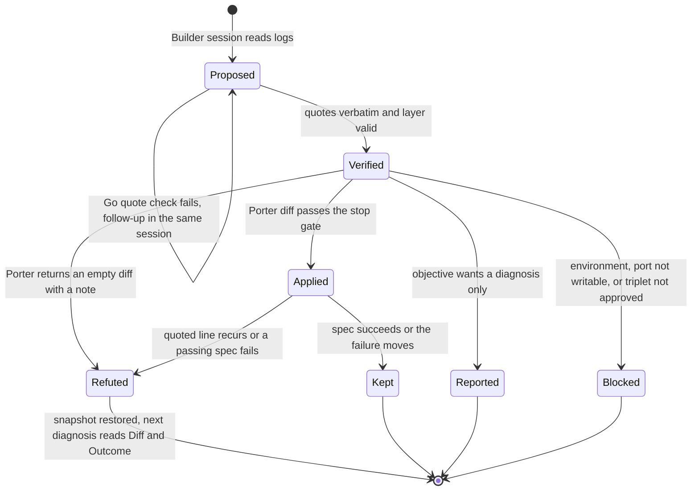
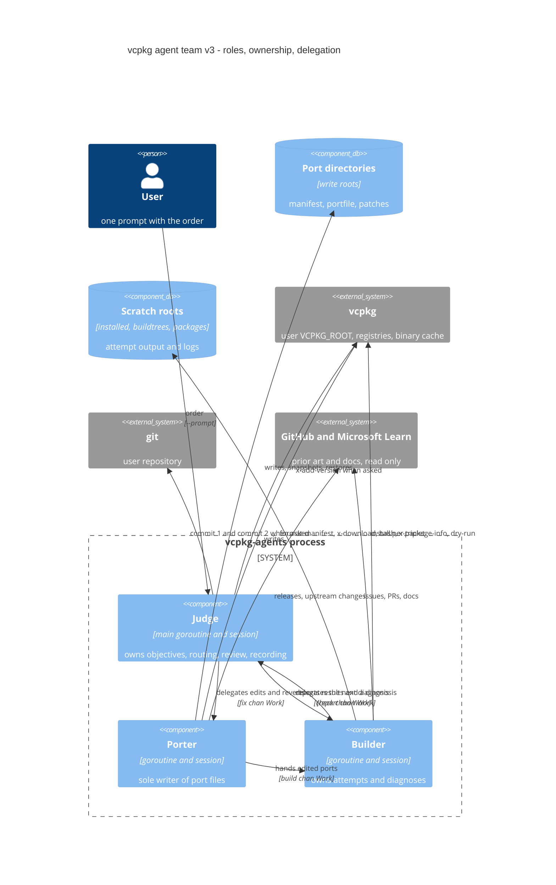
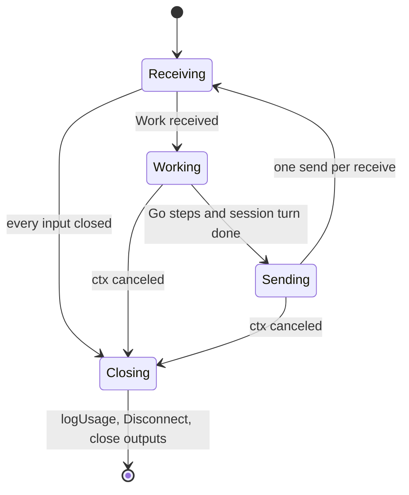
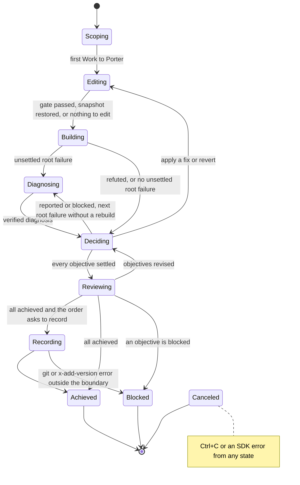
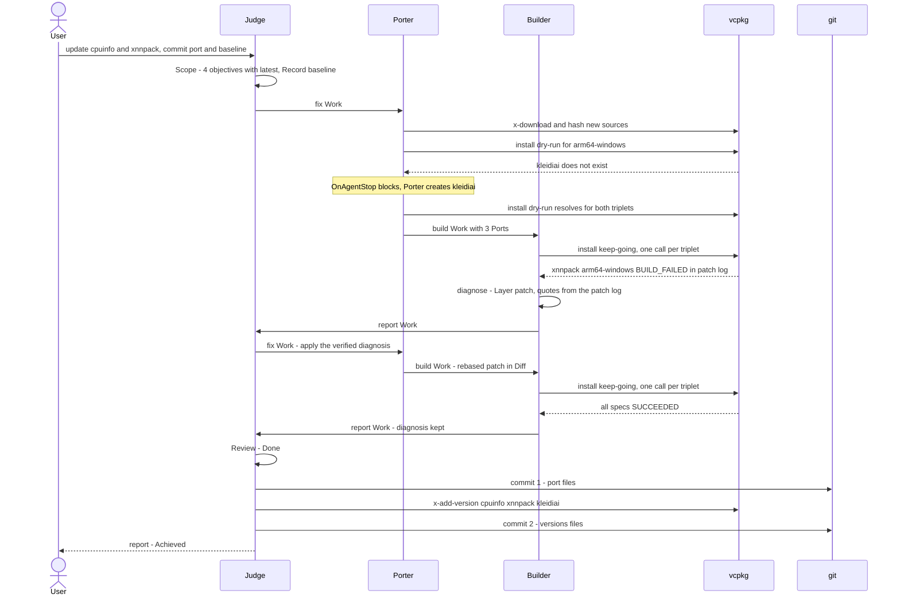
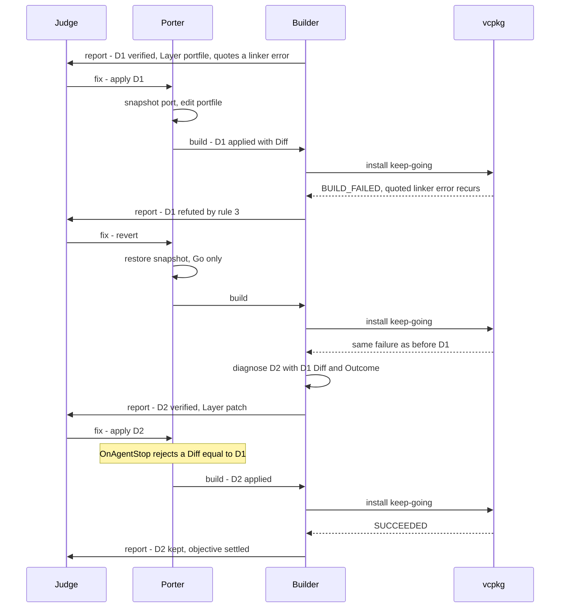

# vcpkg agent team design v3 (pending approval)

## Status and sources

- Status: design only, awaiting user approval. `vcpkg-agents.go` is unchanged. v2 is in commit `ccfe506`.
- Request: "We will Implement 4 workflows (create, update, diagnose, troubleshoot) in vcpkg-agents.go ... each goroutine owns a session, handles messages from multiple in/out channels ... Place `Judge` agent to follow loop engineering ... The agent team may work on multiple ports if the instruction requires it."
- Corrections applied in v3:
  - "NO max iteration. Therefore, no `Exhausted`. ... They MUST accomplish the order ... In the boundary of allowed/approved/limited."
  - "You didn't design tools and hooks."
  - "You're delegating too much jobs to LLM. Several steps can be deterministic with Hooks and exact `vcpkg` command executions."
  - "You can edit triplet if and only if there is no way."
  - "Registry regression is NOT our goal. ... They will aggregate multiple vcpkg registries over vcpkg root."
  - "Be simple. Reduce complexity. I never instructed you to create some command."
  - "Distinguish port update and baseline update. Also, commit must be separated either."
- Superseded from v2: Scout agent, 34-field Ledger, iteration budget and `Exhausted`, `record_*` model tools, `depend-info` and `x-check-support` gates, and registry-wide checks.

## Verified facts

vcpkg 2026-04-08 on a Windows x64 host, VCPKG_ROOT `D:\vcpkg`. Probes ran in temporary folders, which have been deleted.

| Fact | Team use | Source |
|---|---|---|
| A failed build prints `See logs for more information:` with the err log paths, then `error: building <spec> failed with: BUILD_FAILED`, a known-issues search URL for the port, and a `gh issue create --body-file .../issue_body.md` hint | Evidence files, prior-art search | probe |
| `issue_body.md` holds the spec and version, the host and compiler, the vcpkg-tool and scripts versions, and every err log | Diagnosis context | probe |
| With `--keep-going`, `RESULTS` lists every spec as `<spec>: SUCCEEDED, BUILD_FAILED, or CASCADED_DUE_TO_MISSING_DEPENDENCIES`. A cascade prints `due to the following missing dependencies:` followed by its root spec. `issue_body.md` is not written | Results, root-failure attribution | probe |
| `buildtrees/<port>/` has `error-logs-<triplet>.txt` (the list of err logs), `build-<triplet>-err.log`, `-out.log`, `stdout-<triplet>.log`, and `<triplet>.vcpkg_abi_info.txt` | Evidence files | probe |
| Log names name the phase: `patch-<triplet>-<n>`, `config-<triplet>`, `build`, `install` | Evidence locates the phase | `scripts/cmake/z_vcpkg_apply_patches.cmake:20`, `ports/vcpkg-cmake/vcpkg_cmake_configure.cmake:33`, `vcpkg_cmake_build.cmake:10`, `vcpkg_cmake_install.cmake:18` |
| The install plan prints each port's origin: overlay ` -- <path>`, builtin with no suffix (classic), git registry ` -- git+<url>@<git-tree>` (manifest) | Where a port lives | probe, classic and manifest with two `file:///` git registries |
| `--overlay-ports=<one port dir>` overrides a git registry for that port, and the other ports keep their registry | Edits reach vcpkg in any registry setup | probe |
| Every `vcpkg_abi_info.txt` has a `triplet_abi` line | A triplet edit rebuilds every package of that triplet | `D:\vcpkg\buildtrees\vcpkg-cmake\x64-windows.vcpkg_abi_info.txt` |
| Classic `install` into an existing root skips an edited port ("already installed") | Fresh install root per attempt | probe |
| A missing port prints `error: while looking for <port>` and `<port> does not exist`, and exits 1 | Create a missing port | probe |
| A compiler-detection failure aborts a multi-triplet command; `arm64-ios-simulator` fails at triplet load on Windows ("Could not find XCODEBUILD_EXE") | One install per triplet, environment diagnoses | probe |
| `x-package-info <port> --x-json` returns the version and port-version; `list --x-json --x-install-root=<root>` returns installed specs | Version gate, success evidence | probe |
| `install` accepts `--keep-going`, `--dry-run`, `--x-install-root`, `--x-buildtrees-root`, `--x-packages-root`, `--overlay-ports`, `--overlay-triplets`, `--host-triplet`, `--binarysource` | Builder command | `vcpkg help install` |
| `x-add-version` hashes the complete file contents of the port directory, including untracked files; `--overwrite-version` replaces an existing entry | Baseline update preconditions | [add-version](https://learn.microsoft.com/en-us/vcpkg/commands/add-version) |
| A version change sets `port-version` to 0; a change without a new version increments it | Porter gate | [registries](https://learn.microsoft.com/en-us/vcpkg/concepts/registries) |
| A git registry commits the port files first, runs `vcpkg --x-builtin-ports-root=./ports --x-builtin-registry-versions-dir=./versions x-add-version --all`, and then commits the version files | Two commits | [publish to a git registry](https://learn.microsoft.com/en-us/vcpkg/produce/publish-to-a-git-registry) |
| A triplet describes the target environment (CPU, OS, compiler, runtime) for every library built with it | Triplet rule | [triplets](https://learn.microsoft.com/en-us/vcpkg/concepts/triplets) |
| Upstream built-in Windows triplets set `VCPKG_PROVIDED_FORTRAN ON`, and `scripts/cmake/vcpkg_find_fortran.cmake` reads it. The local `D:\vcpkg` (2026-04-28) has neither. PR 613 added the line to this registry's `triplets/x64-windows.cmake` | Triplet example, scenario S8 | `gh search code`, `git show bdaf419` |
| Hooks: `OnPreToolUse` (allow, deny, modify args), `OnPostToolUse` (modify result, add context), `OnAgentStop` (`Decision: "block"` continues the turn with a reason), `OnPermissionRequest`; `SendAndWait[T]` returns typed output | Tools and hooks | copilot-sdk/go v1.0.28 `types.go`, `structured_output.go` |

## Concepts

- **Order**: the user's `--prompt`. It is the only input. The flags stay `--prompt` and `--verbose`.
- **Objective**: one spec `port[features]:triplet` that the order needs, either installed or diagnosed, with an optional version target. A request may cover many ports and triplets.
- **Attempt**: one Go-run `vcpkg install` per triplet, with every edited port passed as an overlay.
- **Diagnosis**: a testable hypothesis about one root failure: evidence, cause, owning layer, and fix.
- **Settled objective**: achieved (installed, or diagnosed and reported) or blocked with a reason. The team stops only when every objective has settled.

### Boundary

| Kind | Content | Enforced by |
|---|---|---|
| Allowed | Reads inside read roots. Porter writes inside the port directories of the objectives, the diagnoses, and new ports. Allowlisted `vcpkg` and `gh` subcommands. Builds inside scratch roots | `OnPermissionRequest`, `OnPreToolUse`, Go-built commands |
| Approved by the order | Commit of port files, baseline update (`x-add-version`) and its commit, triplet edit (G3) | Judge's `Scope`, open gaps G3 and G4 |
| Limited | No writes outside write roots, no change to the user's `installed` tree, no shell, no network writes (`git push`, `gh` writes), no new CLI flags | Hooks deny with a reason |

## Diagnosis

### Terms

- **Evidence**: verbatim lines with their file paths. At least one line comes from vcpkg's failure output: the console output or a file listed in `error-logs-<triplet>.txt`. Others may quote port, source, script, or triplet files. Go checks every line against its file before anything acts on it.
- **Cause**: a hypothesis naming the decision that failed and the layer that owns it. A rebuild tests the fix, so a cause is never proven, only not refuted.
- **Issues (prior art)**: earlier reports and fixes for the same evidence. Sources are the known-issues URL that vcpkg prints, microsoft/vcpkg issues and PRs, and upstream commits. They are inputs to the fix, cited in its text, and are not a field.
- **Layer**: `manifest`, `portfile`, `patch`, `environment`, or `triplet`. Go routes by it.
- **Fix**: the smallest change in the owning layer that would make the quoted failure lines disappear if the cause is true.

### Fix procedure (Builder session)

1. Locate the root failure. Go picks the first root failure in `RESULTS` order (cascades excluded) that has no settled diagnosis, or the triplet when vcpkg fails before any build. The log name gives the phase.
2. Assign the owning layer by asking who decided what failed:

| Layer | Owns | Typical evidence |
|---|---|---|
| manifest | dependencies, features, `"host": true` tools, `supports` | `<port> does not exist`, missing package, tool executed for the wrong architecture |
| portfile | configure options, `VCPKG_TARGET_IS_*` branches, `vcpkg_check_linkage`, install and fixup calls | config log option errors, post-build check messages, `config_fixup` errors |
| patch | the project's build system and source (CMakeLists, meson.build, code) | `patch-<triplet>-<n>` failure, compiler or linker errors in project code |
| environment | the host machine: SDK, NDK, Xcode, network | compiler detection or triplet load errors, missing executables |
| triplet | toolchain governance for every port of that triplet | a vcpkg script line reading a triplet variable, plus the triplet file lines |

3. Search prior art and prefer an accepted fix.
4. Write the smallest fix in that layer that differs from every refuted diff.
5. The rebuild is the test.

### When Evidence or Fix is wrong

| What is wrong | Detected by (Go) | Transition |
|---|---|---|
| Evidence not verbatim, no failure-output line, or Layer outside the enum | Quote check after `SendAndWait` | Proposed again: same session, corrective follow-up |
| Layer `triplet` without a quote from a triplet file | Quote check | Proposed again |
| Fix the Porter cannot express | Empty diff with a note | Refuted with the note; next diagnosis without a rebuild |
| Diff equal to a refuted diff | Porter `OnAgentStop` | Porter continues: a different diff, or an empty one as refusal |
| Quoted failure line recurs in the spec's new logs | Rebuild, rule 3 | Refuted; Porter restores the snapshot, rebuild, next diagnosis sees Diff and Outcome |
| A spec that succeeded in the previous attempt now fails | Rebuild, rule 2 | Refuted (regression), same path |
| Failure moved elsewhere | Rebuild, rule 4 | Kept; Builder diagnoses the new failure; a later diagnosis may name a kept diff as cause by quoting its lines |

Experiment rules after an attempt with an applied diagnosis, evaluated in order:

1. Its spec succeeds: kept.
2. A spec that succeeded in the previous attempt fails: refuted (regression).
3. Its spec fails and a quoted failure line appears in its new logs: refuted.
4. Otherwise: kept (progress).



## Team: roles, ownership, delegation



| Agent | Role | Owns | Delegates to | LLM steps | Go steps |
|---|---|---|---|---|---|
| Judge | Loop owner | objectives, `Record`, recording | Porter (edits, reverts), Builder (next diagnosis) | Scope (order to objectives), Review (done or revised objectives), triplet decision G3 | settle objectives, route, commit 1, `x-add-version`, commit 2 |
| Porter | Sole writer of port files | port snapshots, `Work.Ports`, `Diagnosis.Diff` | Builder | create and update ports, apply a verified fix | revert, format, stop gate, diff |
| Builder | Evidence owner | scratch roots, attempt output, `Objective.Result` | Judge | diagnose one root failure | install per triplet, parse results, experiment rules, quote check |

## Tools and hooks

| Agent | Built-in tools | Custom tools (`DefineTool`, exec without shell) | Hooks |
|---|---|---|---|
| Judge | `view`, `glob`, `rg` | none | `OnPermissionRequest`: reads in read roots, rejects the rest |
| Porter | `view`, `glob`, `rg`, `apply_patch`, `web_fetch` | `vcpkg`: `x-download`, `hash`, `format-manifest`, `x-package-info`, `search`. `gh`: existing `ghReadOnlyCommands` | `OnPreToolUse`: subcommand allowlists. `OnPermissionRequest`: writes only in write roots, with a snapshot of the port directory on its first write in a turn; triplet roots only for an approved triplet diagnosis. `OnPostToolUse`: after a `vcpkg.json` edit, Go runs `vcpkg format-manifest <file>` and adds its output as context. `OnAgentStop`: the gate below |
| Builder | `view`, `glob`, `rg`, `web_fetch`, Learn MCP | `gh`: existing `ghReadOnlyCommands` | `OnPreToolUse`: existing gh allowlist. `OnPermissionRequest`: reads in read roots and scratch, no writes |

Porter stop gate (`OnAgentStop` returns `Decision: "block"` with the failed checks until all pass; an empty diff passes as a refusal):

1. `vcpkg format-manifest` succeeds for every edited manifest.
2. Port-version rule against the run-start snapshot, when the port's registry has `versions/baseline.json`.
3. `vcpkg install <specs> --dry-run --x-install-root=<scratch>/dry --overlay-ports=<each edited dir>` resolves for every triplet. `<port> does not exist` means the Porter creates that port.
4. `vcpkg x-package-info <port> --x-json` shows the objective's version when one is set. Go replaces `latest` with that version.
5. The diff differs from every refuted diff.

### Deterministic steps

| Step | Owner | Exact mechanism |
|---|---|---|
| Tools, environment, manifest, configuration, git root | `init` | existing detection |
| Attempt | Builder | per triplet: `vcpkg install <specs> --keep-going --x-install-root=<scratch>/installed --x-buildtrees-root=<scratch>/buildtrees --x-packages-root=<scratch>/packages --overlay-ports=<each Work.Ports dir>`; installed root deleted before each attempt; console saved to `<scratch>/<triplet>.log` |
| Skip unchanged attempt | Builder | rebuild only when the objective specs or the content of `Work.Ports` differ from the last attempt |
| Results | Builder | `RESULTS` lines, cascade lines, `list --x-json --x-install-root=<scratch>/installed` |
| Next root failure | Builder | first non-cascade failure in `RESULTS` order without a settled diagnosis |
| Quote check | Builder | each quote in its file; one from failure output; Layer in the enum; triplet layer needs a triplet quote |
| Experiment rules 1 to 4 | Builder | previous and current results, quoted lines in `error-logs-<triplet>.txt` files |
| Revert | Porter | restore the snapshot taken before the refuted diagnosis |
| Settle and route | Judge | rules in Team states |
| Port commit, baseline update, baseline commit | Judge | Port update and baseline update section |

## CSP wiring

```go
func main() {
	// flags and init unchanged: --prompt, --verbose
	ctx, stop := signal.NotifyContext(context.Background(), os.Interrupt)
	defer stop()
	client := copilot.NewClient(nil) // Start and Stop as today

	fix := make(chan Work)    // Judge to Porter
	check := make(chan Work)  // Judge to Builder
	build := make(chan Work)  // Porter to Builder
	report := make(chan Work) // Builder to Judge

	go NewPorter(client, *prompt).Run(ctx, fix, build)
	go NewBuilder(client, *prompt).Run(ctx, check, build, report)
	judge := NewJudge(client, *prompt)
	final := judge.Run(ctx, report, fix, check) // main goroutine owns the Judge session
	for range report { // Builder closes report after Porter and Builder disconnect
	}
	judge.Close(ctx)
	slog.Info("report", "content", final)
}

func (j *Judge) Run(ctx context.Context, report <-chan Work, fix, check chan<- Work) string {
	defer close(fix)
	defer close(check)
	w := j.scope(ctx) // SendAndWait[Scope]
	to := fix         // the first Work goes to the Porter
	for {
		if !send(ctx, to, w) {
			return "canceled"
		}
		var ok bool
		if w, ok = receive(ctx, report); !ok {
			return "canceled"
		}
		for to = j.route(ctx, &w); to == nil; to = j.route(ctx, &w) { // nil: every objective settled
			r := j.review(ctx, w) // SendAndWait[Review]
			if r.Done {
				return j.record(ctx, w, r.Report) // only as the order asks
			}
			w.Objectives = r.Objectives
		}
	}
}

func (p *Porter) Run(ctx context.Context, fix <-chan Work, build chan<- Work) {
	defer close(build)
	defer p.close(ctx) // logUsage, Disconnect
	for w := range fix {
		p.revert(&w) // Go: latest diagnosis refuted with a diff
		if p.needsEdit(w) {
			p.edit(ctx, &w) // session turn, OnAgentStop gate, Go fills Diff, Status, Outcome, Ports
		}
		if !send(ctx, build, w) {
			return
		}
	}
}

func (b *Builder) Run(ctx context.Context, check, build <-chan Work, report chan<- Work) {
	defer close(report)
	defer b.close(ctx)
	for check != nil || build != nil {
		var w Work
		var ok bool
		select {
		case w, ok = <-check:
			if !ok {
				check = nil
				continue
			}
		case w, ok = <-build:
			if !ok {
				build = nil
				continue
			}
		case <-ctx.Done():
			return
		}
		if b.attempt(ctx, &w) { // Go: install, results, experiment rules; false after a refutation
			b.diagnose(ctx, &w) // session: one root failure, Go quote check
		}
		if !send(ctx, report, w) {
			return
		}
	}
}
```

- Baton invariant: one `Work` exists, and each goroutine sends exactly once per receive. At most one goroutine holds it; the others wait in receive, so the cycle cannot deadlock.
- Shutdown: the Judge closes `fix` and `check`, the Porter closes `build`, the Builder closes `report` when both inputs are closed, and `main` drains `report`.
- Canceled: Ctrl+C cancels `ctx`; every `send`, `receive`, and session call returns.
- Sessions start on the first message and end with `logUsage` and `Disconnect`, as today.



## Messages and field basis

```go
type Work struct {
	Objectives []Objective
	Diagnoses  []Diagnosis
	Ports      []string // port directories the Porter wrote in this run
}

type Objective struct {
	Spec    string // port[features]:triplet in vcpkg syntax
	Want    string // installed | diagnosed
	Version string // "" keeps; "latest" or a version; Go writes the applied version
	Result  string // vcpkg RESULTS code of the last attempt
}

type Diagnosis struct {
	Spec     string  // root failure spec, or the triplet when vcpkg fails before any build
	Evidence []Quote // verbatim, checked by Go
	Cause    string
	Layer    string // manifest | portfile | patch | environment | triplet
	Fix      string // cites prior art
	Diff     string // Go: port files after the Porter turn versus its snapshot
	Status   string // verified | applied | kept | refuted | reported | blocked
	Outcome  string // Go: experiment result, Porter note, or block reason
}

type Quote struct {
	File string
	Text string
}
```

Judge-only typed outputs: `Scope{Objectives, Record}` and `Review{Done, Objectives, Report}`. `Record` is `""`, `port`, or `baseline`.

| Field | Writer | Reader | Decision it drives | Why it is not derived |
|---|---|---|---|---|
| `Work.Objectives` | Judge | all | what to edit, build, settle | the order is natural language |
| `Work.Diagnoses` | Builder, Porter, Go | Judge, Porter, Builder | apply, revert, report, block, non-repeat | hypotheses and experiment history exist nowhere else |
| `Work.Ports` | Porter (Go) | Builder, Judge | `--overlay-ports` per attempt, commit 1 set, `x-add-version` names | created ports, such as a new dependency, are in no objective |
| `Objective.Spec` | Judge | Builder, Porter, Judge | install arguments, triplet grouping | vcpkg syntax, so vcpkg parses it |
| `Objective.Want` | Judge | Judge, Porter | edits allowed or report only | diagnose and troubleshoot differ only in the order |
| `Objective.Version` | Judge, Go | Porter gate, Judge | update target | stated by the order |
| `Objective.Result` | Builder (Go) | Judge | settle | copy of the vcpkg result code |
| `Diagnosis.Spec` | Builder (Go) | Porter, Judge | port to edit, objectives it settles through cascades | picked from `RESULTS` |
| `Evidence` | Builder session | Go, Porter, user | quote check, rule 3 | the only grounding of a hypothesis |
| `Cause` | Builder session | Porter, next diagnosis, user | understanding of the failure | hypothesis |
| `Layer` | Builder session | Judge, Porter hooks | route, write roots, triplet gate | judgment, enum checked by Go |
| `Fix` | Builder session | Porter | what to change | judgment |
| `Diff` | Go | Porter gate, next diagnosis, user | non-repeat, revert target | content of the experiment |
| `Status` | Go | Judge, Builder | lifecycle | experiment result |
| `Outcome` | Go, Porter | next diagnosis, user | why refuted or blocked | experiment result |
| `Quote.File`, `Quote.Text` | Builder session | Go | verbatim check | evidence |

v2 fields removed (34 to 17):

| v2 field | v3 |
|---|---|
| `Prompt` | system message of each session, as in current code |
| `Iteration`, `Verdict`, `Fingerprints` | no maximum; settle rules; refuted `Diff` |
| `Host`, `Triplets`, `Graph`, `Plan` | vcpkg detects the host, the triplet is in `Spec`, vcpkg builds the graph, cascades name the root, the plan is in the saved console output |
| `Items` (Need, Origin, Goal), `Targets` | `Objective`; the need is derived by gates; the origin is printed in the plan |
| `Blocked`, `Edits`, `Results` | `Status` and `Outcome`, `Ports` and `Diff`, `Result` |
| `Diagnosis.Kind`, `Phase`, `Issues`, `Result.Elapsed` | `Layer`, log name, cited in `Fix`, unused |

## Team states



Judge routing (Go), in order:

1. Settle each objective. Achieved: `Result` is `SUCCEEDED`, and `x-package-info` shows `Version` when set. A diagnosed objective is also achieved when its spec, triplet, or cascade root has a reported diagnosis. Blocked: its spec, triplet, or cascade root has a blocked diagnosis.
2. Every objective settled: Reviewing. `Review.Done` false with unchanged objectives makes Go re-prompt the Judge session.
3. Latest diagnosis refuted with a diff: Porter (revert).
4. Latest diagnosis verified:
   - The affected objectives want only a diagnosis: reported, then Builder through `check`.
   - Layer `environment`, or the port directory is outside the write roots (G2): blocked, then Builder through `check`.
   - Layer `triplet`: G3.
   - Otherwise: Porter (apply).
5. Otherwise, such as objectives revised by Review: Porter, which edits when needed and hands over to the Builder.

Builder invariant: after every attempt that refutes nothing, the Builder appends one diagnosis while any objective is unsettled. A root failure without a settled diagnosis always exists in that case, because an unsettled objective failed, cascaded from a root, or shares a triplet that failed before any build.

No maximum iteration and no `Exhausted` state. Termination comes from settling: each objective ends achieved or blocked by something outside the boundary.

## Triplets and cross-compilation

Rule: the triplet is the consumer's target environment for every port. The port adapts to it. The team edits a triplet only when the evidence shows a toolchain governance setting that every port of that triplet needs, and no port layer can provide it. G3 decides how that is established and who approves it.

| Concern | Layer | vcpkg mechanism |
|---|---|---|
| Build-time tool such as protoc or flatc | manifest, portfile | `"host": true` dependency, `${CURRENT_HOST_INSTALLED_DIR}/tools` |
| Platform-specific options | portfile | `VCPKG_TARGET_IS_ANDROID`, `VCPKG_TARGET_IS_IOS`, `VCPKG_TARGET_ARCHITECTURE` |
| Linkage limits | portfile | `vcpkg_check_linkage` |
| Unsupported platform | manifest | `supports` expression |
| Project assumes host equals target (try_run, find_program) | patch | patch file in the port |
| SDK or NDK missing on the host | environment | blocked, or reported for a diagnosis order |
| Compiler, CRT, linkage default, chainload toolchain, provided Fortran | triplet | triplet file, gated by G3 |

- The Builder runs one install per triplet. vcpkg builds host dependencies for the host triplet itself.
- Triplet files are read-only evidence for every agent until G3 approves an edit.
- A triplet edit changes `triplet_abi` and rebuilds every package of that triplet.

## Multiple registries

- vcpkg runs with the user's working directory and environment: classic mode with `VCPKG_ROOT`, or manifest mode with the user's `vcpkg-configuration.json` registries and overlays (G1).
- The plan line gives each port's origin. Go maps it to a directory: an overlay path, `VCPKG_ROOT/ports/<port>` for builtin, or a writable clone for a git registry (G2).
- Edits reach vcpkg through single-port overlays, so registry resolution and every other port stay unchanged.
- The team builds only the objectives' closure. Registry-wide regression belongs to the registry's own CI.
- Instructions live in the Go system messages. Repository skills and scripts are optional; `SkillDirectories` stays as `init` detects it.

## Port update and baseline update

| | Port update | Baseline update |
|---|---|---|
| Files | `ports/<port>/` | `versions/baseline.json`, `versions/<letter>-/<port>.json` |
| Writer | Porter edits; Judge (Go) makes commit 1 | Judge (Go) runs `x-add-version` and makes commit 2 |
| Commands | `git add -- <Work.Ports>`, `git commit` | `vcpkg x-add-version <ports>` in VCPKG_ROOT; elsewhere `vcpkg --x-builtin-ports-root=<repo>/ports --x-builtin-registry-versions-dir=<repo>/versions x-add-version <ports>`; then `git add -- <versions files>`, `git commit` |
| Preconditions | every objective achieved; Porter gate passed the port-version rule | commit 1 done; `git status --porcelain -- <Work.Ports>` is empty, because the hash includes untracked files |
| Trigger | `Record` is `port` or `baseline` | `Record` is `baseline` |

- A port update without recording leaves the edits in the working tree.
- The consumer baseline (`vcpkg-configuration.json` `baseline`, `x-update-baseline`) is a separate concept (G5).

## Decision basis (5-why)

### Go runs vcpkg
1. Why Go? The command decides which roots vcpkg reads and writes.
2. Why does that matter? The user's `installed` tree and its lock belong to the user.
3. Why not the model? The arguments are a pure function of the objectives and `Work.Ports`.
4. Why prefer a pure function? The same input gives the same command, so outcomes are attributable.
5. Why attributable? The experiment rules depend on it.

### One applied diagnosis per attempt
1. Why one? Refute and revert must know which diff to undo.
2. Why not one per failing port? A fix in a dependency changes the ABI of its dependents.
3. Why accept extra attempts? Unchanged packages restore from the binary cache.
4. Why no maximum? The order must be accomplished; refuted diffs never repeat.
5. Why does the team stop? Each objective settles as achieved or blocked.

### The triplet comes last
1. Why last? A triplet is the target environment for every port built with it.
2. Why does every port matter? `triplet_abi` is part of every package ABI.
3. Why port layers first? The port owns its adaptation through manifest, portfile, and patch.
4. Why ever the triplet? Toolchain governance is shared by every port, as in PR 613.
5. Why gated? The triplet belongs to the consumer.

### Three agents
1. Why not one? Write authority, evidence judgment, and goal judgment stay in separate sessions.
2. Why separate the writer from the diagnostician? A rebuild grades the fix, and the Builder reads that grade.
3. Why no Scout? Host, triplets, graph, and origin come from vcpkg output.
4. Why a Judge? Scope and done are judgments against a natural-language order.
5. Why not more? Every other step is deterministic Go.

## Scenarios

| ID | Order | Path | End |
|---|---|---|---|
| S1 | Update cpuinfo and xnnpack to latest for x64-windows and arm64-windows, then commit the port and the baseline (PR 613 shape) | Porter updates both; dry-run on arm64 prints `kleidiai does not exist`, so the gate makes the Porter create kleidiai; patch failure diagnosed as `patch` and applied; all succeed; commit 1, `x-add-version` for 3 ports, commit 2 | Achieved |
| S2 | Install tensorflow-lite for arm64-android | without the NDK: compiler detection fails, diagnosis `environment` on the triplet, Blocked with the reason; with the NDK: a host tool diagnosis (`manifest` host dependency) is applied and kept | Blocked or Achieved |
| S3 | Why does cpuinfo fail on arm64-ios-simulator | triplet load fails with `Could not find XCODEBUILD_EXE`, diagnosis `environment`, reported, zero edits | Achieved (diagnosed) |
| S4 | Fix libfoo on x64-windows in my vcpkg clone and commit it | classic mode, builtin origin, `VCPKG_ROOT/ports/libfoo` in write roots; fix kept; commit 1, `vcpkg x-add-version libfoo`, commit 2 | Achieved |
| S5 | Make my manifest project build | port from a git registry without a writable clone; diagnosis `patch` verified, port outside write roots, so Blocked with the Fix in the report (G2) | Blocked |
| S6 | Create a port for a GitHub project whose dependency has no port | Porter creates the port; dry-run gate finds the missing dependency; Porter creates it; build and fixes follow | Achieved |
| S7 | Install a port whose first fix is wrong | D1 applied; quoted line recurs; refuted; revert; rebuild; D2 sees D1 and is kept | Achieved |
| S8 | Install lapack-reference on x64-windows with this registry's overlay triplet | evidence quotes `vcpkg_find_fortran.cmake` reading `VCPKG_PROVIDED_FORTRAN` and the triplet file without it; Layer `triplet`; G3 approves the edit or the objective is Blocked with the Fix | Achieved or Blocked |
| S9 | Update every outdated port in this registry | Scope lists every port in the write roots with `latest`; one attempt builds all; root failures are fixed one per attempt; cascades settle with their roots | Achieved or Blocked |





## Mapping to vcpkg-agents.go

| Current | v3 |
|---|---|
| Flags `--prompt`, `--verbose`; `init` detection | unchanged; `init` also feeds read roots, write roots, and scratch |
| `main` pipeline of 5 agents and Ralph loop | 4 channels, Porter and Builder goroutines, Judge loop in `main` |
| `Judge.Achieved` (`ACHIEVED` prefix) | `SendAndWait[Scope]`, `SendAndWait[Review]`, Go routing, settle, record |
| `PortSearchAgent` (dry-run hook) | Porter stop gate (dry-run) |
| `PortUpdateAgent` | Porter |
| `PortInstallAgent` (model chooses arguments) | Builder Go attempt |
| `PortDiagnoseAgent` (gh tool, `preToolUse`, Learn MCP, permission roots) | Builder session, same patterns |
| `ToolCheckAgent` | `init` plus `environment` diagnoses |
| `logUsage`, `Disconnect` | unchanged for every session |

## Open gaps

- G1: build form, classic `install <specs>` or a scratch manifest that copies the user's configuration (relative overlay paths break when copied).
- G2: write roots and the mapping from a git registry URL to a writable clone. Current code uses `<git root>/ports`.
- G3: how "no way except triplet" is established, and who approves a triplet edit.
- G4: order wording that requests a port commit or a baseline update, and the commit message format (this repository uses `[port] update to X (#PR)`).
- G5: consumer baseline updates.
- G6: whether a diagnose-only fix is verified in a scratch copy of the port.
- G7: meaning of "some command". Reading used: the invented `record_*` tools, query tools, `--max-iterations`, and repository-script reporting from v2.
- G8: delivery of Blocked: final report and exit, or approval during the run.
- Noted: cost and time are unbounded by design, and Ctrl+C is the stop. Rule 3 matches verbatim lines, so a fix that only shifts line numbers counts as progress, and the next diagnosis sees it.
