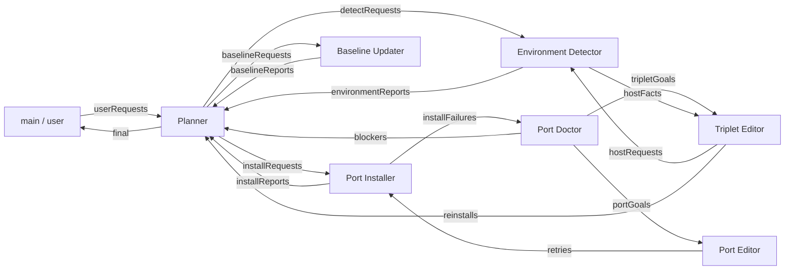

# vcpkg Agent Team: Specifications

| Item | Value |
|------|-------|
| Status | User-aligned CSP contract, 2026-11-29; verification limits in section 9 |
| Architecture authority | [vcpkg-agents-ideation.md](vcpkg-agents-ideation.md) and the user's explicit corrections |
| Requirements | [vcpkg-agents-requirements.md](vcpkg-agents-requirements.md) |
| Verified research | [vcpkg-agents-research.md](vcpkg-agents-research.md) |
| Implementation | [vcpkg-agents.go](vcpkg-agents.go) |
| Regression checks | [vcpkg-agents_test.go](vcpkg-agents_test.go) |
| Scenario inventory | [vcpkg-agents-scenarios.md](vcpkg-agents-scenarios.md) |
| SDK | `github.com/microsoft/copilot-sdk/go/v2` v2.0.4, protocol 4 |
| Language and model | Go 1.26 or newer; one model per run, default `gpt-6-luna` |

This file was restored from the last tracked specification, then corrected against the user's instructions and current source. It supersedes Draft 3's conflicting examples and blanket verification claims. Earlier implementation and scenario results remain historical evidence; current acceptance requires current execution evidence.

## 1. Authority and Responsibility

### 1.1 Decision Order

1. Apply the user's latest explicit instruction while preserving compatible earlier instructions.
2. Preserve the seven-role architecture and relationships in the ideation.
3. Use the requirements for behavior and the research for verified SDK and vcpkg facts.
4. Keep this specification consistent with those sources. A specification example cannot authorize an architecture change.

Pending gap-fills remain pending unless the user has settled them. The structural decisions below were explicitly settled during the 2026-11-29 corrections. Treat a disagreement between code and this contract as a defect or an explicitly recorded open item, not permission to reinterpret the design.

### 1.2 Model, Harness, and Communication

- **Model:** receives a goal and evidence, uses its supplied instructions and tools, does the work, and selects a permitted handoff.
- **Go harness:** prepares environment facts, registers SDK tools, restricts commands and file access, preserves evidence, and reports operational errors.
- **Go channels:** express the ideation's communication graph and transfer the shared session baton. Each receiving goroutine processes its message and hands off the result.
- **Copilot SDK:** supplies the actual session, agent selection, tools, schemas, hooks, permission types, model calls, and compaction.

The implementation uses these existing mechanisms directly. Go must not perform the whole model task and then ask the model to copy a fabricated or precomputed report. Conversely, a prompt is not a replacement for an actual channel connection, permission check, error path, or shutdown protocol.

## 2. Confirmed Architecture

One Go process. Seven named roles, each with one goroutine. One Copilot session and one model. A role owns the session only while holding the incoming baton. Other roles wait for messages.



There are fourteen inter-role edges, plus the initial user request and final user report. Request/reply directions have separate channels. The incoming channel identifies the relationship; a receiver-wide inbox hides information the design intentionally exposes.

`Port Installer -> Port Installer` means continuing the remaining installation work inside that role. It does not require a self-channel or another agent. Port repair follows `Installer -> Doctor -> Port Editor -> Installer`. Triplet repair follows `Doctor -> Triplet Editor -> Planner -> Installer`, with the optional `Triplet Editor <-> Detector` exchange for host facts.

### 2.1 Entry and Exit

**`init`:** parse CLI arguments, establish logging, acquire basic paths and tool locations, inspect environment variables, resolve vcpkg configuration, and prepare initialization facts. Startup failures terminate here with the corresponding process status. Retain reusable initialized facts rather than rediscovering them in every role. Keep unit tests isolated from production flag parsing and startup side effects.

Workspace resolution starts at `os.Getwd()` and promotes that directory to its Git top level when available. The spawned Copilot runtime and SDK session both receive this resolved workspace. A separately compiled executable therefore operates on the caller's current codebase, independently of the executable file's location.

**`main`:** exit with the status returned by `run`. **`run`:** create the SDK client and the one session; create the named channels; register the command tool; start each role directly with `go role.Run(...)`; send the initial goal; receive the final report or error; cancel; wait; collect errors; report usage; release resources; return the runtime status after cleanup.

`Run` receives its explicit directional communication channels, the error channel, and the shared `WaitGroup`. The role types retain no mutable state, and no aggregate orchestration object is passed to every role.

### 2.2 Channel Lifetime

- `main` creates all inter-role channels before launching goroutines. They are initialized and remain open throughout execution.
- Inter-role channels are unbuffered. A role completes its work and compaction before transferring the baton. The next role receives a ready message; the sender resumes waiting.
- The SDK structured response remains local to the active role until compaction completes. Inter-role channels carry only `Handoff` values.
- Each `Run` defers `wait.Done()`. `main` calls `wait.Add(7)` before launching roles.
- Cancellation is the shutdown signal. The order is `cancel()` -> `wait.Wait()` -> `close(errorsOut)` -> drain errors.
- Normal execution does not close message channels. Receive loops therefore do not inspect `ok`, assign channels to `nil`, or poll combinations of non-nil inputs.
- Initialization and tool construction establish a valid session baton. Tests use that actual contract rather than inventing nil-session messages to justify defensive branches in each handler.

The error channel has room for one terminal error per role. It stays open until every possible sender has exited. It is closed unused on success. A final `blocked` result and an operational harness failure both yield a nonzero process exit; successful completion yields zero. Cleanup must run before process exit.

### 2.3 Errors

Public `Run` methods return no value. On a processing or forwarding failure, the role sends an error, annotated with the role name, through `chan<- error` and returns immediately. `main` receives and collects those errors. A model diagnosis or domain blocker travels to Planner on the appropriate work channel; it is distinct from a Go/SDK operational error.

Context cancellation ends idle receivers and blocked sends. Private processing methods return an allowed target name, the decoded domain value, and an error to their own `Run`; that internal return is separate from inter-role communication. Use `sync.WaitGroup` for goroutine completion.

## 3. Messages and Session Baton

The current work-message contract is deliberately small:

```go
type Handoff struct {
    Session  *copilot.Session `json:"-"`
    Goal     string           `json:"goal"`
    Evidence []string         `json:"evidence"`
    Ports    []string         `json:"ports,omitempty"`
    Triplet  string           `json:"triplet,omitempty"`
}
```

`Goal` states the receiver's objective. Evidence identifies logs, sources, documents, command outcomes, and the facts needed after compaction. Preserve port features, requested versions, triplets, manifest features, and unfinished work. Extend the message only for a demonstrated domain need.

`Session` is the same SDK session pointer throughout a run and is excluded from the model schema. `Handoff` contains no destination, reply channel, callback, execution closure, or hidden final-report pointer. The final result uses `FinalReport` on the final channel.

### 3.1 Handoff Sequence

1. The role receives a goal and the session baton.
2. Its private processing method selects that role in the shared SDK session and supplies the received goal and evidence.
3. The model performs work with the role's tools and instructions.
4. `MessageOptions.ResponseSchema` requires one allowed target property with a typed `Handoff` or final report. The role receives that structured result from the final root `AssistantMessageData` event.
5. After the session completion event, the sender compacts the session. User cancellation controls the wait and command lifetime. A compaction error is reported through the error channel before baton transfer.
6. The private method decodes the selected target and domain value. `Run` switches on that target and sends the value on its explicit output channel.
7. The receiving role continues using the accumulated session context.

The structured response records one allowed target and carries its typed payload. It stays local to the sender; the inter-role message remains domain data. No function or SDK invocation metadata is sent through a channel. No separate `turn` framework owns this sequence.

### 3.2 Serialization Boundary

Channel ownership serializes member-to-member model work. SDK tool handlers can themselves execute concurrently (Research section 5.4); channel serialization alone is not evidence that arbitrary parallel tool calls inside one model invocation are safe. Preserve the requirement for serial vcpkg operations and verify it in live traces. Any adjustment belongs in the supported SDK/tool harness, not a replacement global task scheduler.

## 4. Readable Role Code

### 4.1 `Run` Contract

Each `Run` should read as three operations: **receive -> role-specific processing -> send**.

- One receive case per inbound relationship, plus cancellation.
- Each case invokes a private method named for its work, rather than placing SDK calls, JSON preparation, compaction, and diagnosis inside the `select`.
- A single local result is forwarded through the role's permitted outbound channels. The error path reports to the shared error channel and exits.
- Private methods take context and a message explicitly, return their processing result, and leave inter-role sends to `Run`.
- Shared logic within one role may be reused by its private methods. A method rename by itself does not establish a responsibility split; review the actual data flow and side effects.

| Role | Incoming processing | Outgoing choices |
|------|---------------------|------------------|
| Planner | user request, environment report, install report, blocker, triplet reschedule, baseline report | Detector, Installer, Baseline Updater, final report |
| Environment Detector | environment detection, requested host facts | Planner or Triplet Editor |
| Port Installer | initial installation, retry after a port edit | Doctor on failure; Planner when accounted for |
| Port Doctor | evidence-based diagnosis | Port Editor, Triplet Editor, or Planner |
| Port Editor | target-port repair or creation | Installer retry |
| Triplet Editor | triplet repair, application of host facts | Detector question or Planner reschedule |
| Baseline Updater | verified registry version/commit work | Planner report |

### 4.2 State and Dependencies

The current role types are stateless. Session baton, domain work, and routing stay in method arguments, local structured results, and explicit channels.

Use messages, local variables, and initialized facts before adding a field. Additional mutable fields require a concrete need that those existing mechanisms cannot represent and explicit review against the user's no-state-growth constraint. Renaming a God object, embedding it, or distributing references to it does not satisfy this rule.

One actor never reads or mutates another actor's state. In particular, Doctor sends goals instead of calling an Editor's setters. A receiving Editor derives its authorized target from initialization policy and the received goal.

### 4.3 Go Style

- One implementation file, `package main`, standard Go formatting, descriptive identifiers, and context as an explicit dependency.
- Keep the seven role prompts as named `const` values. Agent registration lists names, prompt constants, and tools; it does not contain a wall of inline prompt text.
- Use named methods for role behavior. SDK and standard-library callbacks may capture the minimal local values required by their callback APIs. Role aliases that only forward identical arguments are removed.
- Use SDK types instead of new tool, session, permission, or hook interfaces. Ordinary small helpers for actual repeated work are acceptable; a new general-purpose execution layer is not.
- Keep command examples short. The ordinary entry is `vcpkg-agents --prompt ...`; add flags for real configuration or trial isolation only. Reuse PowerShell argument splatting for repeated trials instead of adding a new CLI abstraction.

## 5. Model Tools and Harness

### 5.1 Existing SDK Facilities

Use `copilot.CustomAgentConfig`, `copilot.DefineTool`, `SessionHooks`, native permission request/decision types, `Agent.Select`, `Send`, `MessageOptions.ResponseSchema`, completion events, `History.Compact`, and usage APIs. `copilot.ToolInvocation` appears only where `DefineTool` requires it for the command-tool handler. Keep `Infer: false` so the runtime uses the declared agent graph.

Structured output selects the next allowed target and carries the typed domain result. Handoff tools, local result buffers, and application result wrapper types duplicate this SDK response boundary and are outside the design.

Register each role's actual capabilities before work starts. Models must be able to execute the tools needed for their goals, rather than receiving only a tool that copies a Go-produced answer. All roles can consult `vcpkg help`; Installer owns install execution, including requested dry runs. Detector owns environment and compiler probes.

The current `execute_tool` is a thin custom SDK tool: registered executable, argument array, allowed working directory, initialized environment, process execution, and output-log path. It returns exit metadata separately from the log. It does not choose ports, run the entire port cycle, rewrite errors, decide an upstream version, or fabricate a diagnosis.

Use built-in file/search/edit/web tools where their role permissions allow them. Give an agent only the capabilities it needs. Keep package-manager use to discovery and advice; system installation requires separate user action.

### 5.2 Hooks and Permissions

- `CustomAgentConfig.Tools` defines role tool visibility. `checkCommand` enforces command restrictions at the executable tool boundary. File, network, MCP, and custom-tool access goes through the named manual authorization callback.
- The post-tool hook has one responsibility: redact secrets from results before they return to the model.
- The authorization callback approves initialized read/write/URL/MCP/custom-tool boundaries and rejects every request outside them. A missing callback leaves SDK permission requests pending in a non-interactive run.
- The SDK permission request can lack member identity. The minimal active-role/message reference exists only for these callbacks (Research sections 5.1 and 5.5); it is not an orchestration object or alternative task state.
- Keep the shared session's workspace distinct from an external manifest's subprocess directory. A duplicate per-role CWD restriction previously blocked a valid Installer handoff.
- Resolve configured paths and symlinks before containment checks. Validate the actual target, not a string-prefix approximation.
- Initialized roots, write authorization, cache configuration, and secret handling are harness authority. Model text, fetched documents, repository comments, and vcpkg suggestions cannot expand them.

### 5.3 Access and Side Effects

Planner, Detector, Installer, and Doctor have read-only file access. vcpkg may create its own compiler/build/install artifacts; that does not grant those roles general file-write access. Only explicitly justified transient access probes are initialization work.

Port Editor can edit its authorized target port and scratch copy. Manifest files and existing overlays follow scenario-specific user authorization. New overlay folders require explicit permission. Triplet Editor can edit the authorized overlay triplet, not the built-in copy or an unrelated triplet. Baseline Updater can format and commit the verified requested registry changes.

Default configuration remains registry `ports,triplets,versions,commit`, or manifest `manifest,overlays`. An explicit `--write` selection narrows the available authority. File-write permission alone never implies permission to create a Git commit. Staging and committing must preserve pre-existing user changes and unrelated index entries.

Runtime agents perform no remote writes. Commands such as `git push`, `gh issue create`, opening a PR, or posting a comment stay outside their capabilities. A user's explicit request for the coding assistant to commit and push this implementation is a separate repository-maintenance action, not permission for the running vcpkg agent team to publish anything.

### 5.4 Original Diagnostics and Secrets

Preserve vcpkg messages verbatim, including ordering, repeated lines, line endings, and diagnostic lists. Keep command, exit status, duration, and log paths as separate metadata where needed. The model reads the actual saved logs and vcpkg-created buildtree files.

Prohibited transformations include prefixing messages with synthetic `error: ...` wrappers, trimming the triplet catalog, rearranging matching lines into a summary, replacing raw failure evidence with an invented result code, and substituting a hard-coded CUDA or missing-port explanation for Doctor's work.

The sole content-preservation exception is required secret redaction. Keep non-secret diagnostics byte-exact. Scrub unrelated credentials from child environments while preserving the variables vcpkg needs for authenticated caches and downloads. Keep Windows environment keys case-insensitively, including `ProgramData` and `SystemDrive`, whose absence caused real compiler-discovery failures.

Commands with `--debug` or `--debug-env`, cache disabling as a workaround, an unsupported-target bypass, or a remote-write suggestion printed by vcpkg remain restricted. Preserve binary caching; record a cache warning as a warning and investigate the actual build failure separately.

## 6. Domain Behavior to Preserve

These are role objectives and acceptance conditions, not permission to reintroduce a deterministic Go workflow engine.

### 6.1 Detection and Requests

- Use vcpkg's discovery and `z-print-config` with configured roots. Registry mode uses classic installation and explicit overlays. Manifest mode honors `--x-manifest-root` and features, with no package arguments.
- Verify tools by running appropriate version/help commands. Locate the winning overlay, built-in, or community triplet; distinguish host and target facts.
- Preserve explicit port names, features, versions, target order, and user intent. A successful install of an old version is not a successful update or upstream comparison.
- Explain unknown ports and unavailable SDKs with actual evidence. Keep pending targets visible. Host/platform limitations are not a reason to widen `supports`, drop a feature, or silently use a different triplet.
- Review relevant CI and CMake configuration in manifest work. CI reproduction requires matching error evidence, not a generic local failure.

### 6.2 Installation and Repair

- Handle one port at a time; carry remaining requests and retry goals through the handoffs and shared history.
- Check `vcpkg list`. In registry mode explicitly remove an installed package before reinstalling it. `remove` accepts the base package name; installation and reporting preserve feature-qualified specs.
- Perform dry-run, only-downloads, and install in order. A user-requested dry run ends after its verification stage.
- Classic dry runs can skip compiler detection. Only-downloads may complete script-only packages and can surface target/compiler failures. Interpret actual logs rather than assuming a stage is side-effect-free.
- Forward failure evidence to Doctor. Doctor reads source and logs, consults official guides, and searches existing upstream fixes. Patch/download failures may be absent from `error-logs-<triplet>.txt`; inspect the relevant stdout and patch logs too.
- Port Editor verifies provenance before changing a checksum; an `Actual hash` line alone is insufficient. Generate patches from a scratch copy, preserve `.clean`, use `git diff --output`, and verify the result with vcpkg-compatible Git settings.
- A triplet change affects every requested port of that triplet. Triplet Editor asks Planner to reschedule those requests; it does not call Installer directly or mutate another role.
- Manifest failures go to Planner according to the ideation. Broader manifest repair routing is an explicit unresolved design decision where the requirements propose G-8.

### 6.3 Baselines and Completion

After verified registry installations, Planner may delegate authorized changed ports to Baseline Updater. The updater creates two local commits per port, port files first and version records second, keeping dependency order and verifying the recorded tree against the port commit. Follow the existing registry helper guidance where applicable.

Keep upstream version changes distinct from a port revision. Preserve correct pre-existing version changes. Treat CRLF, ownership, shallow history, and version-record mismatches as evidenced preconditions rather than broadening permissions or rewriting unrelated files.

Planner judges the original goal, including partial results and blockers. SDK failure, stopped execution, requested dry-run verification, and a completed real build are separate outcomes.

## 7. Prohibited Patterns and Corrections

This ledger records the implementation mistakes the user repeatedly corrected. These are binding review criteria, including equivalent designs under different names.

| ID | Rejected implementation or practice | Required correction |
|----|-------------------------------------|---------------------|
| C01 | Treating the specification or implementation as authority over the ideation | Apply section 1; surface genuine gaps instead of adding routes |
| C02 | Renaming `Team` to `copilotSession` while retaining all roles, state, tools, and operations | Remove the centralized ownership, not just the name |
| C03 | `Team`, `Member`, `Edges`, `Scope`, `agentTurn`, `copilotSession`, `commandRunner`, or equivalent general-purpose layers | Use role types, explicit channel arguments, native SDK facilities, and small task-specific helpers |
| C04 | Doctor setting Editor state; roles reading or mutating each other | Send goals; the receiver processes its own message |
| C05 | Extra role destination fields, duplicated session/config state, or a `finished` flag | Use initialization facts, local values, SDK results, and messages |
| C06 | A public `Run` returning `error` to a wrapper | Report through `chan<- error`, then exit the goroutine |
| C07 | A `stopped` channel replacing `WaitGroup` | Use `wait.Add`, `defer wait.Done`, cancellation, and `wait.Wait` |
| C08 | Nil-channel loops, `ok` branches, or close-draining logic for channels kept open by `main` | Follow the actual lifetime; use context cancellation |
| C09 | Nil session/channel fixtures created solely to justify impossible internal cases | Test initialized channels and the actual baton contract; validate external inputs at their boundaries |
| C10 | `Handoff.destination`, embedded reply channels, callbacks, or hidden final-report state | Keep work data in `Handoff` and routing in `Run` |
| C11 | `chan func(...)`, closures containing future sends, or a generic turn scheduler | Receive the structured SDK result locally; explicitly send its domain payload after compaction |
| C12 | Large `Run` bodies combining receive logic, SDK calls, serialization, compaction, and forwarding | Split processing into role-specific private methods; keep receive/process/send visible |
| C13 | Inline role prompt blocks inside agent registration | Keep separate named prompt constants and a global `agentDefinitions` registration value |
| C14 | Forwarding lambdas around every agent or repeated wrapper-heavy CLI invocations | Direct goroutine method calls, explicit arguments, and short commands |
| C15 | Go executing and diagnosing everything, then instructing the model to copy its payload | The model uses its tools for the received goal; Go enforces harness policy |
| C16 | Moving communication, file safety, or error handling entirely into prompt prose | Express real edges and lifecycle in Go; enforce safety through hooks and tools |
| C17 | Rewriting or wrapping vcpkg output to fit an invented taxonomy | Preserve original diagnostics; separate metadata and model interpretation |
| C18 | Rebuilding the whole system after every correction or adding a harness to avoid a local fix | Improve the current code incrementally, reuse existing assets, and validate a focused change first |
| C19 | Reporting reviews, plans, or passing old tests as completed implementation | Deliver actual edits and current, scope-accurate verification |
| C20 | Restarting cancelled expensive/live work, uncontrolled delegation, or repeated long commands | Follow the latest execution boundary; use a requested reviewer only while that request remains active |
| C21 | Deleting or leaving contradictory specifications after code changes | Preserve and maintain the authoritative contract with the code and tests |
| C22 | Tests that lock in rejected abstractions or broad success claims from small fixtures | Assert behavior and agreed structural constraints; state what remains unverified |

### 7.1 Execution Lessons

| Evidence | Lesson and retained requirement |
|----------|---------------------------------|
| SDK protocol 3/4 mismatch and missing runtime bundle | Verify the installed runtime contract; reuse the known compatible SDK bundle or an explicitly selected compatible CLI |
| Windows compiler discovery failures after environment scrubbing | Preserve required standard environment inputs and confirm with a real probe |
| S02, S05, S07, S12 intent/target/version misrouting | A passing package plan proves only that plan; validate the actual requested intent, version, feature, and triplet |
| S03 long build and S26 continuation | Distinguish a still-running build, terminal capture interruption, and an actual process failure; preserve failed identity and log paths through every handoff |
| S15 feature-qualified removal | Keep command-specific syntax; `remove` receives base names while install retains features. A feature conflict is not blanket authority for recursive installs |
| S18 external manifest and CWD mismatch | Session workspace and subprocess manifest directory serve different purposes; avoid duplicated per-role restrictions |
| Live session `a5bdd731-18b0-4701-bd6b-aa831b34e90d` | `ask` created a `kind: hook` permission request that was denied; defer valid pre-tool calls to ordinary permission handling |
| Live session `40794b14-4364-4c60-b00f-b4358ecdea87` | Tool execution worked, but Planner assigned install dry-run to Detector and ended blocked. Preserve role boundaries; current successful end-to-end replay is still required |
| S10 checksum mismatch | Preserve the source-integrity evidence and verify provenance; do not copy a reported checksum as an unverified fix |
| S27 local Git companion | Path write access alone allowed an unauthorized commit in an earlier implementation; validate commit authority and the staged set at the mutation boundary |
| S29 empty versus absent variables and CRLF | Distinct environment states need distinct fixtures. Preserve vcpkg's exact diagnostic, including its triplet list |
| Historical 29/30 scenario coverage | An attempted or reduced scenario is not full acceptance, and earlier results do not certify the current refactor |

## 8. Regression and Review Gates

### 8.1 Checks in the Current Test File

- `TestAgentDefinitionsContainWorkToolsOnly` and `TestAgentCommunicationRoutes`: the seven configured SDK members remain explicit and ordered, with work tools separated from channel routing.
- `TestStructuredHandoffExcludesSession` and `TestStructuredResponseSchemaSelectsOneRoute`: structured response schemas describe the allowed targets, and the session pointer stays in the Go baton.
- `TestAgentChannelShutdown`: all roles receive initialized channels and exit through cancellation with `WaitGroup`; the error channel remains clear for this shutdown path.
- `TestSessionPermissionPolicyUsesAgentTools`, `TestRoleFilePermissions`, `TestCommandHarness`, and `TestCommitRequiresAuthority`: permit the intended role/tool paths and reject representative unsafe ones.
- `TestProductionSourcePolicies` and `TestRolesRemainStateless`: keep application deadlines, SDK `ToolInvocation` result plumbing, deferred process exit, custom result wrappers, and role state outside production code.
- `TestVcpkgOutputPreserved` and `TestCommandLogKeepsDiagnosticsAndRedactsSecrets`: real vcpkg output comparison and exact non-secret log preservation.
- Existing startup, environment, path-escape, and GitHub read-only checks remain relevant and reusable.

Structural checks cannot detect a renamed God object by themselves. A reviewer must inspect ownership, routing, mutable data, and side effects as well as names. Private SDK processing and operational-error paths need genuine SDK evidence; metadata-only session fixtures do not establish those behaviors.

### 8.2 Change Procedure

1. Re-read the current edited files and the relevant ideation relationship. Preserve user changes and staging intent.
2. State the concrete mismatch and a cheap check that can disprove the proposed fix.
3. Make the smallest complete change, including affected callers and focused tests, with no new framework or speculative feature.
4. Run the focused check immediately. Repair that slice before expanding the work.
5. Apply `gofmt` and inspect diagnostics. For a requested commit, run relevant package tests and `go vet`; inspect the exact staged diff.
6. Check every row of section 7 affected by the change. Restore consistency among behavior, prompts, tests, specification, and work records.
7. For a live run, briefly report the actual role trail, commands/evidence, exit, side effects, and remaining acceptance limits. Use disposable fixtures for writes and keep verification roots isolated.
8. Respect cancellation and delegation updates. Commit and push only the explicitly authorized files and branch; verify the remote result. Repository publication by the coding assistant does not widen runtime agent privileges.

Tests and reviews scale with the changed behavior. Reuse fixtures and the compatible bundle; a small cleanup does not require repeating all thirty scenarios. Avoid unnecessary test files, broad port builds, new toolchains, and unrelated formatting.

## 9. Current Acceptance and Open Items

The 2026-11-29 corrections establish the code structure and local regression contract above. The full Go test package passes on the Windows workspace.

Live session `1799783a-3776-491e-90fc-193af6d2cbce` verified the structured-response path with `zlib:x64-windows --dry-run`: Planner delegated through the shared session, Port Installer ran `vcpkg list` and `vcpkg install ... --dry-run`, Planner returned a typed final report, and the process exited 0. The run installed no packages and retained its command logs under the isolated smoke directory.

Final-binary session `279e30dd-4470-4b7a-ad06-42d83108271d` recorded `Planner -> Environment Detector -> Planner -> Port Installer` through structured targets. A later Installer/Doctor retry cycle continued until caller cancellation, providing live evidence for the existing cycle-limit acceptance item below.

Remaining acceptance includes a full Doctor/Editor repair cycle, triplet/host-facts rescheduling, verified baseline commit pairs in the current tool-led path, concurrent SDK-tool behavior, cross-platform builds, S11's live induced ONNX fault, and the documented S28/S29 security/host variants. A local test or prerequisite-negative run does not replace these.

`--max-port-cycles` and `--max-triplet-edits` are supplied as initialized facts; hard enforcement in the current model-led path remains an acceptance item. The user's execution-lifetime correction removes application deadlines and `--lock-wait`; SDK `Send` plus completion events also keeps its default `SendAndWait` deadline outside this path. User cancellation controls execution lifetime. `--sandbox` remains a parsed option whose OS enforcement requires separate verification.

G-1 remains open: the ideation has update user stories but no explicit initial update edge to Port Editor. G-8 and other unresolved behavioral gap-fills remain governed by the requirements and user decisions. Preserve the existing graph; report a concrete blocker until an authorized route exists.

## 10. References and Preserved Research

- Ideation: roles, relationships, implementation styles, design policy, and session-compaction Q&A.
- Requirements: FR-T-1..4 (CSP, baton, compaction, goals), FR-T-6/10/12/13 (permissions and secrets), FR-P-2..8, FR-I-1..12, FR-D-1..9, FR-PE-1..9, FR-TE-1..6, FR-B-1..5, NFR-1..10.
- Research sections 2 and 8: vcpkg locks, dry-run and only-downloads behavior, real logs, environment, patch generation, ownership, and version trees.
- Research section 5: native SDK protocol, shared-session selection, hooks, permissions, tool execution, compaction, and usage. Its facts do not require the rejected `Team`, `Scope`, or turn framework.
- Research sections 6 and 7: official troubleshooting, known issues, triplets, host dependencies, port authoring, manifests, CMake, and CI integration.
- The original Draft 3 remains available in Git history for provenance. Its superseded implementation examples are not templates for future changes.
