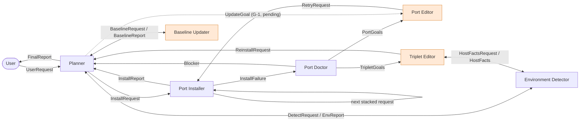
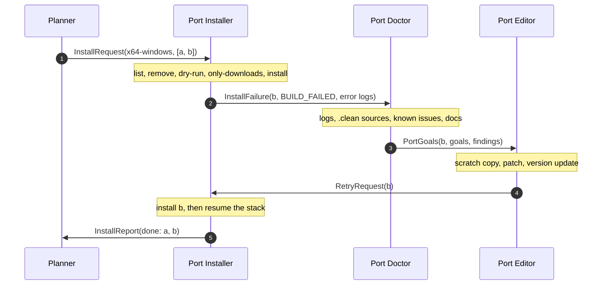
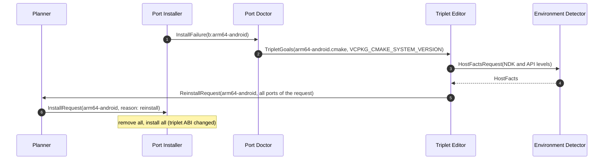
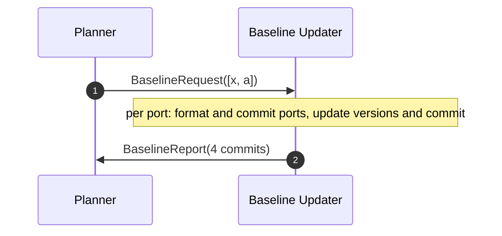

# vcpkg Agent Team: Specifications

| Item | Value |
|------|-------|
| Status | Draft 2, 2026-11-28 (research and live tests merged) |
| Architecture source | [vcpkg-agents-ideation.md](./vcpkg-agents-ideation.md) (fixed) |
| Requirements | [vcpkg-agents-requirements.md](./vcpkg-agents-requirements.md) |
| Facts and tests | [vcpkg-agents-research.md](./vcpkg-agents-research.md) |
| Style reference | [vcpkg-agents.go](./vcpkg-agents.go) (style only, not design) |

This document maps the ideation onto Go and the Copilot SDK for Go v2 (`github.com/microsoft/copilot-sdk/go/v2`). It adds no member and no relationship. **Gap-fill** marks a detail the ideation leaves open; each cites a gap ID from the requirements, section 9.

## 1. Architecture

The team is one Go process. Seven members run as goroutines. They talk over typed Go channels. They share one Copilot session. Exactly one member takes a turn at a time.



Orange members have write scopes. The dashed edge is not in the ideation. It is shown only to locate gap G-1.

## 2. Process Model

### 2.1 `init`

`init` runs deterministic checks and stores the results in package-level variables (Ideation §Implementation Styles):

1. Parse flags (section 2.3). Set up `log/slog`.
2. Find tool paths with `exec.LookPath`. The Copilot CLI path comes from `COPILOT_CLI_PATH` or `LookPath("copilot")`; `init` records its version, because the SDK protocol must match it (Research §5.1).
3. Read `VCPKG_*` variable names and classify them (section 10). Values of secret-bearing variables are never stored in logs.
4. Find the git root (`git rev-parse --show-toplevel`).
5. Run `vcpkg z-print-config`, passing designated roots and `--x-manifest-root`. It takes no lock and writes nothing. It returns `buildtrees`, `downloads`, `installed`, `packages`, `vcpkg-root`, `default-triplet`, `host-triplet`, and `manifest-mode-enabled`.
6. Detect the scenario (section 3) and log the evidence.
7. Resolve the write scopes (section 9).

### 2.2 `main`

1. Start the Copilot client.
2. Create the shared session (section 4).
3. Create the channels (section 5) and start the member goroutines.
4. Send the `UserRequest` to the Planner.
5. Wait for the `FinalReport` and drain the error channel.

The error channel is closed unused on success. On failure it carries every error, and the process exits non-zero (Ideation §Implementation Styles). A `sync.WaitGroup` closer goroutine closes it after all members return.

Runs are non-interactive (**Gap-fill G-22**): no member asks the user during a run. There is no resume in v1 (**Gap-fill G-24**): after a crash the user reruns the command, and binary caching restores finished ports.

### 2.3 CLI Flags

| Flag | Meaning | Source |
|------|---------|--------|
| `--prompt` | The user request. Required. | Draft style |
| `--verbose` | DEBUG logging. | Draft style |
| `--model` | The single model for all members. | FR-T-8 |
| `--overlay-ports`, `--overlay-triplets` | Explicit overlay folders, repeatable. | Ideation §registry scenario |
| `--x-buildtrees-root`, `--x-packages-root`, `--x-install-root` | Designated roots, passed to every vcpkg call. | Ideation §Environment Detector |
| `--x-manifest-root` | Manifest folder when not at the root. | Ideation §manifest scenario |
| `--write` | Write scopes: `ports`, `triplets`, `versions`, `manifest`, `overlays`, `create-overlays`, `commit`. Default by scenario. | **Gap-fill G-6** |
| `--max-port-cycles` (3), `--max-triplet-edits` (1) | Failure limits. | **Gap-fill G-10** |
| `--lock-wait` (10m) | Budget for waiting on a vcpkg lock held by another process. | **Gap-fill G-19** |

## 3. Scenario Detection

**Gap-fill G-5.** Detection reuses vcpkg's own discovery, so the team and vcpkg always agree.

| Order | Evidence | Scenario |
|-------|----------|----------|
| 1 | `z-print-config` reports `"manifest-mode-enabled": true` (vcpkg found `vcpkg.json` from the working directory upward, or from `--x-manifest-root`). | manifest |
| 2 | The git root (or the working directory) has `ports/` and `versions/baseline.json`. | registry: installs run in classic mode with explicit overlays (**Gap-fill G-26**) |
| 3 | Neither. | registry, classic mode; the Planner reports that the workspace has no registry layout. |

Hybrid workspaces follow the working directory. Example: this repository's root is a registry; its `test/` folder holds a manifest. The decision, the evidence, and the losing candidate are logged at INFO.

## 4. Shared Session and Handoff

### 4.1 Session Setup

`main` creates one session (`client.CreateSession`). The SDK is `github.com/microsoft/copilot-sdk/go/v2` (v2.0.4 or newer), because the installed Copilot CLI 1.0.114 speaks protocol 4 and the draft's v1.0.28 speaks protocol 3 (Research §5.1). The client uses `ClientOptions{Mode: ModeCodingAgent, Runtime: SpawnedStdioConnection{Path: <copilot CLI from init>, Env: <scrubbed environment>}}`.

The SDK mapping below is a **spec choice**. The live probe in Research §5.1 verified every row marked "live".

| Ideation need | SDK v2 feature | Evidence |
|---------------|----------------|----------|
| One session, one model | One `copilot.Session`; `CreateSessionOptions.Model` | source |
| Member roles | `Agents.Definitions`: one `CustomAgentConfig` per member, with `Name`, `Prompt`, `Tools`, and `Infer: copilot.Bool(false)`, so the runtime never delegates to a member by itself | live |
| Member takes its turn | `session.RPC.Agent.Select(ctx, &rpc.AgentSelectRequest{Name})` before the turn. The selected member can call only the tools in its `Tools` list. | live |
| Per-member permissions | One `Permissions.OnRequest` handler and one `Hooks.Handlers.OnPreToolUse` hook. Neither receives a member identity, so both read the active member from an `atomic.Pointer` set at handoff and apply that member's policy (section 9). | live |
| Compact before send | `session.RPC.History.Compact` with `Trigger: manual` and `CustomInstructions` that name the handoff state. The agent selection and the shared history survive it. | live |
| Usage per member | `session.RPC.Usage.GetMetrics` before and after each turn. All usage lands under `main`, so the team attributes the difference to the active member. | live |
| Message provenance | `MessageOptions.Source: copilot.MessageSourceAgent(<sender>)` on each turn prompt | source |

Constraints from Research §5.2 to §5.6:

- Only the baton holder may call `Send` or `SendAndWait`. The runtime queues concurrent sends and has no session locking.
- Every turn passes a context with an explicit deadline; `SendAndWait` otherwise waits only 60 seconds.
- No member tool sets `SkipPermission`: such tools bypass the permission handler. The pre-tool-use hook guards every tool.
- Every tool result sets `TextResultForLLM`.
- `Session.On` handlers only copy events into a buffered channel; a blocking handler stalls the session.
- Never use `ResumeSession` to switch members: it replaces the handle and can interrupt a running tool call. v1 has no crash resume (**Gap-fill G-24**). A later version that adds one must pass `ContinuePendingWork: true`.

Fallback if `Agent.Select` changes in a later SDK: switch members with live reconfiguration (`Session.SetTools`, `RPC.Options.Update` for available tools, `RPC.Permissions.Configure`) and send the member's role prompt at the start of its turn.

### 4.2 Handoff Protocol

A member that receives a message takes these steps:

1. Mark itself active (`team.active.Store(member)`) and snapshot usage.
2. Select its custom agent.
3. Send the goal and evidence from the message as the prompt (`SendAndWait`, with the member's deadline).
4. Collect its outbound message. The model emits it by calling the member's handoff tool (section 6.2). Handoff tools are `IsTerminal`, so a successful call ends the turn. The Go handler validates the fields against the message type and rejects invalid calls, so the model must retry.
5. Compact the session (FR-T-3) and log the result.
6. Attribute the usage difference to the member.
7. Send the outbound message on the channel. This passes the session identity (FR-T-2).

Messages are self-contained: goal, evidence, paths (NFR-3). Compaction may then drop details without loss.

### 4.3 Turns Without the Model

Some steps are deterministic: running vcpkg commands, parsing logs, formatting, version updates. A member's tool handler runs them inside the member's turn. The model sees a bounded summary, never the raw terminal output (FR-I-6).

### 4.4 Team-wide Prompt Rules

The session system message holds the rules every member follows. Each custom agent prompt adds the member's role, inputs, outputs, and write scope from section 7.

1. You are one member of a team. Other members exist; you reach them only through your handoff tools.
2. Work toward the goal in the message. Do not expect step-by-step instructions, and do not send any (FR-T-4).
3. Base every claim on evidence: a log path with lines, a document URL, an issue, or a pull request. Mark each finding as fact, observation, or interpretation.
4. When a vcpkg command rejects your arguments, run `vcpkg_help` for that command and retry (FR-T-5).
5. End your turn by calling exactly one handoff tool. Put everything the next member needs into it: the session is compacted before it reaches them (FR-T-3, NFR-3).
6. Never print secret values. Never run `gh issue create` or any command that writes to a remote service (FR-T-12, FR-T-13).
7. Binary caching problems are warnings, not errors (FR-T-11).

## 5. Message Catalog

Each edge of the ideation is one typed channel. A member's `Run` loop selects over its inbound channels and `ctx.Done()`.

```go
// Handoff is embedded in every message. It carries the session identity and the goal.
type Handoff struct {
	SessionID string   // shared session identity (FR-T-2)
	From      string   // sender member name
	Goal      string   // what the receiver must achieve; not steps (FR-T-4)
	Evidence  []string // log paths, document URLs, issue and pull request links
}
```

| Message | Edge | Fields besides `Handoff` | Ideation source |
|---------|------|--------------------------|-----------------|
| `UserRequest` | main to Planner | `Prompt` | §Relationships, "The start" |
| `DetectRequest` | Planner to Environment Detector | `Triplets []string` (requested or guessed), `Reply chan<- EnvReport` | §Planner <-> Environment Detector |
| `EnvReport` | Environment Detector to Planner | `Scenario`, `ScenarioEvidence`, `Roots` (z-print-config), `Overlays`, `Triplets []TripletFile`, `Tools []ToolInfo`, `Variables []VariableStatus`, `Access []FolderAccess`, `Web`, `PackageManagers`, `Host`, `Compiler`, `Warnings`, `Blockers` | §Environment Detector |
| `InstallRequest` | Planner to Port Installer | `Triplet`, `Ports []string` (registry specs such as `name[feature]`), `Features []string` (manifest, **Gap-fill G-7**), `ManifestRoot`, `Reason` (user, reinstall) | §Planner -> Port Installer |
| `InstallReport` | Port Installer to Planner | `Done []Spec`, `Unresolved []Unresolved` (spec, last failure, attempts) | §Port Installer -> Planner |
| `InstallFailure` | Port Installer to Port Doctor | `Spec`, `Triplet`, `Stage` (dry-run, downloads, build), `ExitCode`, `ResultCode` (for example `BUILD_FAILED`), `Command`, `ErrorLogs []string`, `IssueBody`, `OutputLog`, `Attempt` | §Port Installer -> Port Doctor |
| `PortGoals` | Port Doctor to Port Editor | `Port`, `Goals []string`, `Diagnosis []Finding` (may cover several ports), `NewPort *NewPortGoal` | §Port Doctor -> Port Editor |
| `TripletGoals` | Port Doctor to Triplet Editor | `TripletFile`, `Variables []string`, `Guidance` | §Port Doctor -> Triplet Editor |
| `Blocker` | Port Doctor to Planner | `Spec`, `Category`, `Reason`, `Findings []Finding` | §Port Doctor -> Planner |
| `RetryRequest` | Port Editor to Port Installer | `Spec`, `Triplets []string`, `ChangedFiles []string` | §Port Editor -> Port Installer |
| `ReinstallRequest` | Triplet Editor to Planner | `Triplet`, `TripletFile`, `Change`, `Ports []string` | §Triplet Editor -> Planner |
| `HostFactsRequest` / `HostFacts` | Triplet Editor to Environment Detector, with reply | `Question`, `Reply chan<- HostFacts` / `HostTriplet`, `Compilers`, `SDKs`, `Notes` | §Triplet Editor <-> Environment Detector |
| `BaselineRequest` / `BaselineReport` | Planner to Baseline Updater, and back | `Ports []string` / `Commits []Commit`, `Skipped []string` | §Planner <-> Baseline Updater |
| `FinalReport` | Planner to main | `Status` (finished, blocked), `Ledger []LedgerEntry`, `Commits`, `Warnings` | §Port Installer -> Planner |

`Finding` holds `Kind` (fact, observation, interpretation), `Text`, and `Source` (path with line, URL, or issue).

Request and reply edges (`DetectRequest`, `HostFactsRequest`) carry a reply channel. Without it, a cycle of unbuffered sends can deadlock. The Port Installer's inbound request channel is buffered, so the Planner can send several requests in sequence (§Planner -> Port Installer).

## 6. Tools

### 6.1 Tool Set

| Tool | Kind | Members | Side effects | Guard |
|------|------|---------|--------------|-------|
| `view`, `glob`, `rg` | built-in | all | none | read roots per member |
| `edit`, `create`, `apply_patch` | built-in | Port Editor, Triplet Editor, Baseline Updater | file writes | write scope per member |
| `web_fetch` | built-in | Port Doctor, Port Editor, Triplet Editor | network | URL permission |
| shell (`powershell` or `bash`) | built-in | members with a shell policy (section 9) | per command | command policy per member in `OnPreToolUse` |
| `skill` | built-in | all (optional) | none | none |
| `vcpkg_help` | custom | all | none | topic must be a word |
| `vcpkg_query` | custom | Environment Detector, Port Installer, Port Doctor | none | subcommand allowlist: `version`, `z-print-config`, `list`, `search`, `depend-info`, `x-package-info`, `help` |
| `vcpkg_install` | custom | Port Installer | vcpkg roots | stage flag required; explicit `--triplet`; explicit overlays and designated roots added by Go |
| `vcpkg_remove` | custom | Port Installer | vcpkg roots | registry scenario only (G-12) |
| `read_log` | custom | Port Installer, Port Doctor | none | path inside a vcpkg root; returns a bounded tail and matching lines |
| `probe_tool` | custom | Environment Detector | none | runs `<tool> --version`-style commands from an allowlist |
| `detect_compiler` | custom | Environment Detector | vcpkg `buildtrees`, locks | runs `vcpkg x-set-installed vcpkg-cmake:<triplet> --dry-run` and parses the `#COMPILER_*` lines; Go always adds `--dry-run`, because `x-set-installed` without it removes every other installed package |
| `gh_read` | custom | Port Doctor, Port Editor, Environment Detector | network | read-only subcommands (as in the draft) |
| `vcpkg_create` | custom | Port Editor | port folder | target inside the write scope |
| `make_patch` | custom | Port Editor | scratch folder, port folder | **Gap-fill G-9** |
| `download_sha512` | custom | Port Editor | network | HTTPS only |
| `version_update` | custom | Baseline Updater | `ports/<port>/vcpkg.json` format, `versions/` | registry scripts when present; otherwise `vcpkg format-manifest` and `vcpkg x-add-version` |
| `git_commit` | custom | Baseline Updater | git index and history | paths limited to `ports/<port>/` or `versions/` |
| MCP `microsoft-learn` | MCP | Port Doctor, Triplet Editor | network | read-only |
| MCP enterprise (optional) | MCP | Port Doctor | network | read-only, configured by flag |
| Handoff tools | custom | each member | none | one per outbound message type; schema from Go struct tags |

### 6.2 Handoff Tools

Each member gets one tool per outbound message type, for example `send_install_failure` and `send_port_goals`. `copilot.DefineTool` derives the JSON schema from the Go struct (`jsonschema` tags), as in the draft. Handoff tools set `IsTerminal: true`, so a successful call ends the member's turn (Research §5.4). The handler validates the fields and stores the message for step 4 of section 4.2.

### 6.3 vcpkg Invocation Rules

1. Pass `--triplet` on every call. Pass `--host-triplet` when designated.
2. Pass overlays explicitly with `--overlay-ports` and `--overlay-triplets` (Ideation: "need to be explicit"). Report overlays that come from `VCPKG_OVERLAY_*` variables or `vcpkg-configuration.json`.
3. Pass designated roots on every call (`--x-buildtrees-root`, `--x-packages-root`, `--x-install-root`).
4. Write stdout and stderr to a team log file per call. Return only: exit code, duration, the plan (dry run), the `RESULTS` states (`SUCCEEDED`, `DOWNLOADED`, `BUILD_FAILED`, ...), each `error: building <spec> failed with: <RESULT>` line, the paths listed in `buildtrees/<port>/error-logs-<triplet>.txt`, the `<installed>/vcpkg/issue_body.md` path, the `info: loaded overlay triplet from here` and `info: installing overlay port from here` lines, and binary cache warnings (Research §8.1, §8.2, §8.8).
5. On an unknown argument, the member runs `vcpkg_help` for the command and retries (FR-T-5).
6. Lock contention (**Gap-fill G-19**): pass `--x-wait-for-lock` on every command that takes the locks. The tool handler watches the output stream for `note: waiting to take filesystem lock...`. If waiting exceeds the budget (`--lock-wait`, default 10 minutes), it stops vcpkg and the Port Installer reports a blocker with the lock path. Without the flag, vcpkg fails after about 1.5 s (Research §8.3).
7. vcpkg prints a `gh issue create -R microsoft/vcpkg ...` command after a failure. No member runs it (FR-T-13). `gh_read` rejects every write subcommand.

## 7. Members

Each member lists: inputs, outputs, tools, scopes, behavior, and completion. Behavior is stated as goals and checks, not scripts (FR-T-4).

### 7.1 Planner

- Inputs: `UserRequest`, `EnvReport`, `InstallReport`, `Blocker`, `ReinstallRequest`, `BaselineReport`.
- Outputs: `DetectRequest`, `InstallRequest` (one per triplet, in sequence), `BaselineRequest`, `FinalReport`.
- Tools: `view`, `glob`, `rg`, `vcpkg_help`, handoff tools. No writes (FR-P-5).
- Behavior:
  1. Delegate detection first (FR-P-2).
  2. Turn the request into ordered requests per triplet. Example: `arm64-windows` with its ports, then `arm64-android` with its ports.
  3. Judge each report. A report that meets the user's goals ends the run with `finished`. A blocker that removes every remaining path ends it with `blocked`.
  4. In the registry scenario, after success, send `BaselineRequest` for the changed, verified ports (FR-P-7).
  5. On `ReinstallRequest`, reschedule the affected requests (FR-P-6).
- Completion: sends `FinalReport` with the ledger.

### 7.2 Environment Detector

- Inputs: `DetectRequest`, `HostFactsRequest`.
- Outputs: `EnvReport`, `HostFacts`.
- Tools: `probe_tool`, `detect_compiler`, `vcpkg_query`, `vcpkg_help`, `gh_read` (auth and rate limit only), `view`, `glob`. No file writes (FR-E-5). `detect_compiler` lets vcpkg write its own `buildtrees` logs, as the ideation's "vcpkg detect_compiler" requires.
- Procedure (identical to `init`, FR-E-10):
  1. Tools: path and version of vcpkg, git, gh, cmake, ninja, shells, curl, tar; meson, pkg-config, zip, unzip, python where relevant; compilers; package managers (apt, winget, Chocolatey, Homebrew).
  2. vcpkg roots and triplets from `z-print-config`.
  3. Overlays from flags, `VCPKG_OVERLAY_*`, and `vcpkg-configuration.json`.
  4. For each requested or guessed triplet: the winning file. Search order: overlay folders, then built-in `triplets/`, then `triplets/community/`. `vcpkg help triplet --overlay-triplets=<dir>` lists overlay triplets in a section `Overlay Triplets from "<dir>":`.
  5. `VCPKG_*` variables: names, status, and checks (section 10).
  6. Folder access for roots, caches, overlays, and write scopes (**Gap-fill G-14**): read access everywhere; write access by creating and deleting one uniquely named probe file, only in folders the team plans to write and in the vcpkg roots. Binary cache folders are checked directly: vcpkg dry runs do not validate binary sources (Research §8.6, L6m).
  7. Web access: GitHub (`gh api rate_limit`) and Microsoft Learn.
  8. Compiler facts: `detect_compiler` runs `x-set-installed ... --dry-run` (2 s on the test host), then reads `buildtrees/detect_compiler/stdout-<triplet>.log`: `#COMPILER_HASH#`, `#COMPILER_C_ID#`, `#COMPILER_C_VERSION#`, `#COMPILER_C_PATH#`, and the `CXX` equivalents. A failure here means the host cannot build the triplet (Research §8.5).
  9. Manifest scenario only: triplets and features used by CI. Sources: `CMakePresets.json` and `CMakeUserPresets.json` `cacheVariables` (`VCPKG_TARGET_TRIPLET`, `VCPKG_MANIFEST_FEATURES`, overlays, `VCPKG_INSTALLED_DIR`, `VCPKG_INSTALL_OPTIONS`), `VCPKG_MANIFEST_FEATURES` set before `project()` in `CMakeLists.txt`, `CMakeSettings.json` `variables`, and workflow `matrix.triplet`, `VCPKG_DEFAULT_TRIPLET`, `-DVCPKG_TARGET_TRIPLET`, or `--preset` (Research §7.4, §7.5).
  10. vcpkg root clone state: `git rev-parse --is-shallow-repository`, the HEAD commit, and, with network access, how far upstream master is ahead (GitHub compare API). Manifest scenario: whether the clone contains each baseline commit (`git cat-file -e <sha>^{commit}`). A missing baseline commit fails installs (Research §6.6, §7.3).
  11. Registry scenario, git environment for version commands: the file system type of the registry (exFAT, FAT, and network shares record no ownership), whether vcpkg's git can open the repository without the home variables, the effective `core.autocrlf`, `.gitattributes` line-ending rules for `ports/`, and whether port files in the working tree are LF. Any failure blocks the Baseline Updater (Research §8.10).
- Completion: one `EnvReport`, or `HostFacts` for the Triplet Editor.

### 7.3 Port Installer

- Inputs: `InstallRequest` (buffered), `RetryRequest`.
- Outputs: `InstallFailure`, `InstallReport`.
- Tools: `vcpkg_query` (`list`), `vcpkg_remove`, `vcpkg_install`, `read_log`, `vcpkg_help`, handoff tools. No direct file creation (FR-I-9).
- Stack (**Gap-fill G-11**): requests run in arrival order. A retry runs before the remaining requests.
- Per request:
  1. `vcpkg list` records the installed state.
  2. Registry scenario: `vcpkg remove` the requested ports for the triplet (`--recurse` when dependents exist). Classic mode never rebuilds an installed port, so this step is required before every retry (Research §8.1).
  3. `vcpkg install --dry-run` checks that every port is known. Classic dry runs skip compiler detection, so they cannot catch an unsupported target.
  4. `vcpkg install --only-downloads` gets sources and runs compiler detection. It reports `RESULTS` per spec (`SUCCEEDED`, `DOWNLOADED`) and catches unsupported targets (Research §8.5, §8.8).
  5. `vcpkg install` builds in the foreground.
  6. Read `error-logs-<triplet>.txt` and `issue_body.md` on failure.
- Manifest scenario: the same stages run without port arguments, with `--x-manifest-root` and `--x-feature`. No `remove`: vcpkg rejects it and rebuilds changed ports by itself (G-12; Research §8.4). To reproduce a CMake configure, run the command `vcpkg.cmake` runs, with the same triplet, features, overlays, and install root (Research §7.4).
- On failure: send `InstallFailure` for the first failed port. Count the attempt.
- On retry: install the changed port. On success, resume the stack.
- Limits (**Gap-fill G-10**): after `--max-port-cycles` failed cycles, the port is unresolved and the Port Installer continues with the rest.
- Completion: `InstallReport` to the Planner when the stack is empty.

### 7.4 Port Doctor

- Inputs: `InstallFailure`.
- Outputs: `PortGoals`, `TripletGoals`, `Blocker`.
- Tools: `view`, `glob`, `rg`, `read_log`, `vcpkg_query`, `vcpkg_help`, `gh_read`, `web_fetch`, MCP `microsoft-learn`, optional enterprise MCP. No writes.
- Behavior:
  1. Find the failed stage first (Research §6.2), then the axis. Read `stdout-<t>.log`, the paths in `error-logs-<t>.txt`, and `patch-<t>-*-err.log`. `error-logs-<t>.txt` never lists patch, download, hash, or post-build failures.
  2. Classify the failure: build configuration, toolchain, installation, or misc (Research §6.3).
  3. Staleness check: compare the port with upstream history (`gh api "repos/microsoft/vcpkg/commits?path=ports/<port>&since=<baseline date>"`). The local clone may be shallow and behind (Research §6.6). An upstream fix becomes a blocker ("update the vcpkg clone") or, in the registry scenario, an upstream copy of the fixed port.
  4. Search known issues in this order: `scripts/ci.baseline.txt`, issues with `<port> in:title`, the exact signature phrase, merged pull requests, Discussions. Count a closed issue as fixed only if its `stateReason` is `COMPLETED` or a pull request closed it (Research §6.5).
  5. Read the official troubleshooting guides. Prefer exact strings from vcpkg sources over the 2024 guide text.
  6. Write findings as facts, observations, and interpretations, each with a source.
  7. Set goals that let the Port Installer start with confidence. A hash mismatch needs a provenance check (moved tag, unstable archive) before a new `SHA512`. A post-build warning maps to the helper the message names, not to a `VCPKG_POLICY_*` escape hatch.
- Routing (**Gap-fill G-8**):

| Fix target | Writable under current scopes | Next member |
|------------|-------------------------------|-------------|
| Port files, a new port, or `vcpkg.json` in the manifest scenario | yes | Port Editor |
| Triplet file | yes | Triplet Editor |
| Any target | no | Planner (`Blocker`) |
| Unsupported host or missing SDK | not applicable | Planner (`Blocker`) |

### 7.5 Port Editor

- Inputs: `PortGoals`; `UpdateGoal` if G-1 adds that edge.
- Outputs: `RetryRequest`.
- Tools: `view`, `glob`, `rg`, `edit`, `create`, `apply_patch`, `vcpkg_create`, `make_patch`, `download_sha512`, `gh_read`, `web_fetch`, `vcpkg_help`, handoff tools.
- Write scope: the target port folder. Manifest scenario: also `vcpkg.json`, `vcpkg-configuration.json`, and overlay ports (**Gap-fill G-7**).
- Manifest edits follow vcpkg rules (Research §7.1, §7.2): strict JSON; a baseline change to upgrade in general, `version>=` for one port, `overrides` for an exact pin; never `builtin-baseline` next to a configuration-file `default-registry` (the configuration wins and the baseline is ignored); never `.` as an overlay path.
- Patch workflow (**Gap-fill G-9**, verified in Research §8.9):
  1. Copy `buildtrees/<port>/src/<name>.clean` to a team scratch folder. `make_patch` runs `git init`, then `git add -A` and a baseline commit.
  2. Edit the copy.
  3. `make_patch` runs `git diff --output=<file>` and writes `ports/<port>/<name>.patch`. Every git call uses `-c core.autocrlf=false` and `GIT_CONFIG_NOSYSTEM=1`. The diff never passes through a shell pipe, so line endings stay exact.
  4. `make_patch` verifies the patch on a fresh copy of `.clean` with vcpkg's own command: `git -c core.longpaths=true -c core.autocrlf=false -c core.filemode=true --work-tree=. --git-dir=.git apply <patch> --ignore-whitespace --whitespace=nowarn --verbose`.
  5. Append the patch to `PATCHES`, after the existing patches. The `.clean` folder already has those patches applied.
  6. Delete the scratch folder. No untracked file may stay in the port folder, because `x-add-version` hashes untracked files.
- Repository tips (**Gap-fill G-17**): follow the workspace's own guides and patch conventions (names, numbering, style of existing patches). Start each new patch with a short header that states why it exists and, when known, the upstream issue or pull request.
- Versions: change `version` or `port-version` per vcpkg rules. Leave them if `git diff` shows they already changed (FR-PE-5).
- New port: `vcpkg create <name> <url> --x-builtin-ports-root=<target ports folder>` writes the template into the target folder (Research §8.7). The template computes `SHA512` but uses `vcpkg_download_distfile` and the deprecated `vcpkg_extract_source_archive_ex`. The Port Editor replaces them (for example with `vcpkg_from_github`), then completes configure, install, config fixup, copyright, and usage.
- Completion: `RetryRequest` with the changed files.

### 7.6 Triplet Editor

- Inputs: `TripletGoals`.
- Outputs: `ReinstallRequest`, `HostFactsRequest`.
- Tools: `view`, `glob`, `rg`, `edit`, `create`, `web_fetch`, MCP `microsoft-learn`, `vcpkg_help` (`triplet`), handoff tools.
- Write scope: writable overlay triplet folders. A built-in triplet is changed by creating an overlay copy (US-7.3).
- Behavior: read the triplet in use, read the official triplet variables, evaluate the candidates, apply one change, and state its effect.
- Every triplet change alters `triplet_abi` and invalidates cached binaries for that triplet. The Port Installer rebuilds every port of that triplet.
- Limit (**Gap-fill G-10**): `--max-triplet-edits` per triplet per run.
- Completion: `ReinstallRequest` to the Planner.

### 7.7 Baseline Updater

- Inputs: `BaselineRequest`. Registry scenario only.
- Outputs: `BaselineReport`.
- Tools: `version_update`, `git_commit`, `view`, `vcpkg_help`, handoff tools.
- Per port, 2 commits (FR-B-2):
  1. Format the port (`registry-format.ps1` when present, else `vcpkg format-manifest`). Commit `ports/<port>/`.
  2. Update the version database (`registry-add-version.ps1` when present, else `vcpkg x-add-version <port>` with `--x-builtin-ports-root` and `--x-builtin-registry-versions-dir` for non-upstream registries). Commit `versions/`.
- Order (**Gap-fill G-16**): dependencies first, so that a new or changed dependency port is committed before the ports that need it. Ties follow the order in which the team changed the ports.
- `--overwrite-version` (**Gap-fill G-21**): only for a version entry that is not yet on the base branch. Otherwise `x-add-version` fails, and the Baseline Updater reports the port to the Planner, which reports it as blocked ("`port-version` not bumped"). No ideation edge leads from the Planner back to the Port Editor (see G-1).
- Tree guard: after the version commit, the `git-tree` recorded for the port must equal `git rev-parse <port commit>:ports/<port>`. The ideation's first commit makes this exact. A mismatch means the working tree's line endings differ from the commit (Research §8.10); the Baseline Updater reverts its version commit and reports a blocker.
- Not used: `x-ci-verify-versions`. It assumes a complete registry and reports false errors for ports that come from upstream (Research §8.10).
- Preconditions reported by the Environment Detector: the registry's file system records ownership, or vcpkg's git can see a `safe.directory` entry; port files are LF in the working tree.
- Completion: `BaselineReport` with the commit list.

## 8. Flows

### 8.1 Port Cycle (US-2.2)



### 8.2 Triplet Path (US-2.4)



### 8.3 Registry Finish



## 9. Permission Policy

Deny by default. The handler and the hook read the active member.

| Member | Read | Write | Shell policy | Network |
|--------|------|-------|--------------|---------|
| Planner | workspace, vcpkg roots | none | none | none |
| Environment Detector | workspace, vcpkg roots, tool folders | one transient probe file per planned write folder (G-14) | probe allowlist: version and path commands, package manager search | GitHub and Learn reachability |
| Port Installer | workspace, vcpkg roots | none (vcpkg writes its roots) | none; vcpkg only through custom tools | downloads by vcpkg |
| Port Doctor | workspace, vcpkg roots | none | read-only: `git log`, `git show`, `git diff` | web, `gh_read`, MCP |
| Port Editor | workspace, vcpkg roots | target port folder; manifest files (G-7); scratch folder (G-9) | `git diff`, `git status` | web, `gh_read` |
| Triplet Editor | workspace, vcpkg roots | writable overlay triplet folders | none | web, MCP |
| Baseline Updater | workspace | `ports/<port>/` (format only), `versions/`, git commits | registry scripts, `git add`, `git commit` scoped to the port | none |

Default write scopes (**Gap-fill G-6**):

| Scenario | Default `--write` |
|----------|-------------------|
| registry | `ports`, `triplets`, `versions`, `commit` |
| manifest | `manifest`, `overlays` (existing overlay folders only) |

`create-overlays` (new `ports/` or `triplets/` in the manifest scenario) is never a default.

Enforcement inputs (Research §5.5): `Read.Path`, `Write.FileName` and `Write.Diff`, `URL.URL`, `CustomTool.ToolName` and `Args`, and for shell commands `FullCommandText`, `Commands[].ReadOnly`, `HasWriteFileRedirection`, and `PossiblePaths`. A shell command passes only if every command is in the member's policy, no write redirection targets a path outside the write scope, and every possible path is inside the read or write roots.

## 10. Environment Variables and Secrets

**Gap-fill G-13.**

- `init` and the Environment Detector record each `VCPKG_*` and `X_VCPKG_*` variable by name, with a status: set, path exists, path writable, parse result.
- Values are shown only for variables that hold no credentials: roots, triplets, overlay folders, flags.
- Values of `VCPKG_BINARY_SOURCES`, `X_VCPKG_ASSET_SOURCES`, NuGet settings, `X_VCPKG_RECURSIVE_DATA`, proxy credentials, and any variable whose name or value suggests a secret (`TOKEN`, `KEY`, `SECRET`, `sig=`, `AccessKey`) are never logged or sent to the session. Secret-bearing sources are reported as structure only: provider, host, read/write mode, SAS expiry and permissions (Research §4.7).
- The team lints binary and asset sources before vcpkg sees them, because a vcpkg parse error prints the whole value (Research §4.6).
- No member passes `--debug` or `--debug-env` to vcpkg. Probes pass `--disable-metrics`.
- vcpkg child processes keep what vcpkg and the builds need: system variables, every variable vcpkg reads (Research §4.2), proxies, and names in `VCPKG_KEEP_ENV_VARS`. Secrets that vcpkg does not read (for example `GITHUB_TOKEN`, or custom `VCPKG_`-prefixed credentials) are removed. On Linux and macOS this matters most: vcpkg passes the full environment into port builds (Research §4.3).
- Tool output passes a redactor before it reaches the model.

Behavior the Environment Detector reports (Research §8.6):

| Condition | Effect | Report as |
|-----------|--------|-----------|
| `VCPKG_DEFAULT_TRIPLET` or `VCPKG_DOWNLOADS` set but empty | Every vcpkg command fails | Blocker |
| `VCPKG_ROOT` differs from the root next to `vcpkg.exe` | vcpkg ignores it with a warning | Warning |
| `VCPKG_OVERLAY_PORTS` set | Used after `--overlay-ports`; first folder wins | Fact (overlay order) |
| `VCPKG_KEEP_ENV_VARS` set | Passes variables into Windows builds without changing the ABI hash | Warning: untracked build input |
| `VCPKG_BINARY_SOURCES` or `VCPKG_DEFAULT_BINARY_CACHE` points to a missing folder | Dry runs stay silent; a missing `VCPKG_DEFAULT_BINARY_CACHE` folder is fatal at first real use | Warning, or blocker for `VCPKG_DEFAULT_BINARY_CACHE` |
| `VCPKG_MAX_CONCURRENCY` not a positive integer, or `X_VCPKG_REGISTRIES_CACHE` not an existing absolute folder | Fatal at first use | Blocker |
| Legacy `VCPKG_FEATURE_FLAGS` values (`registries`, `binarycaching`, `manifests`, `versions`) | No-ops; all are on by default | Fact |
| `x-gha` in binary sources | Removed provider; vcpkg only warns | Warning |

The full variable table is in the research document.

## 11. Failure Paths

| Failure | Detected by | Next | Limit |
|---------|-------------|------|-------|
| Unknown port, version conflict | dry run | Port Doctor | port cycle |
| Download or hash mismatch | `--only-downloads` | Port Doctor, then Port Editor (URL, `SHA512`) | port cycle |
| Configure, build, or install error | full install | Port Doctor | port cycle |
| Triplet cause | Port Doctor | Triplet Editor, then Planner | `--max-triplet-edits` |
| Unsupported host or target, missing SDK | `--only-downloads` (compiler detection), Environment Detector, or Port Doctor | Planner, as a blocker | none |
| Binary cache warning | Port Installer | logged, continue | none |
| Lock held by another vcpkg process | Port Installer (`failed to take lock`) | wait with `--x-wait-for-lock` (G-19), then Planner as a blocker | `--lock-wait` |
| SDK or tool error | any member | error channel | none |

## 12. Logging

- `log/slog` text handler. INFO by default; DEBUG with `--verbose`.
- Keys: `agent`, `session`, `message`, `tool`, `args` (redacted), `path`, `exit`, `duration`.
- INFO: scenario decision, every handoff (from, to, message type), every write approval, every vcpkg call (command, exit, duration), compaction start and end, usage per member.
- DEBUG: tool arguments, hook decisions, read approvals.

## 13. Coding Style

Taken from the draft:

- One file, `package main`. Doc comments start with the identifier and link the official document they rely on.
- System and member prompts are constants. A prompt that embeds the user request takes it through `%s`.
- `init` parses flags, sets logging, runs checks, and logs each result. Check functions are exported and named `Check...`.
- A member type has `New<Member>(...)`, `Run(ctx, inputs..., outputs...)`, a permission method, and a pre-tool-use method.
- `Run` uses `defer` to close its outputs and logs every reply at INFO with the `agent` key.
- Tool parameters are structs with `json` and `jsonschema` tags. Tool handlers return `"error: %v\n%s"` text instead of Go errors, so the model can read failures.
- Path checks use one helper (`insideAny`).
- Timeouts use `context.WithTimeout` per call.
- SDK v2 groups session options (`CreateSessionOptions{Tools, Agents, Permissions, Hooks, ...}`) where the draft's v1 used a flat `SessionConfig`. The draft's style carries over unchanged otherwise.

## 14. Open Items

- G-1 (critical, needs user decision): how update requests reach the Port Editor. Recommended: Planner to Port Doctor. Not adopted, because it adds an edge.
- Open: G-20, G-23.
- Pending confirmation: G-6 to G-11, G-14 to G-17, G-19, G-21, G-22, G-24, G-26.

See requirements section 9.
