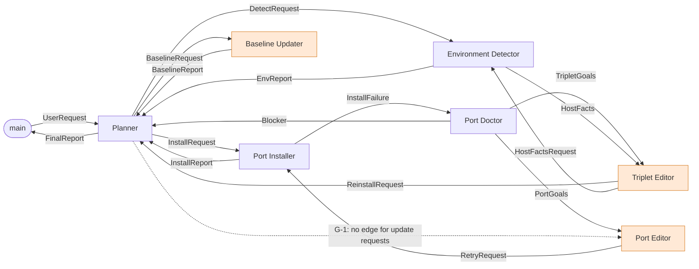
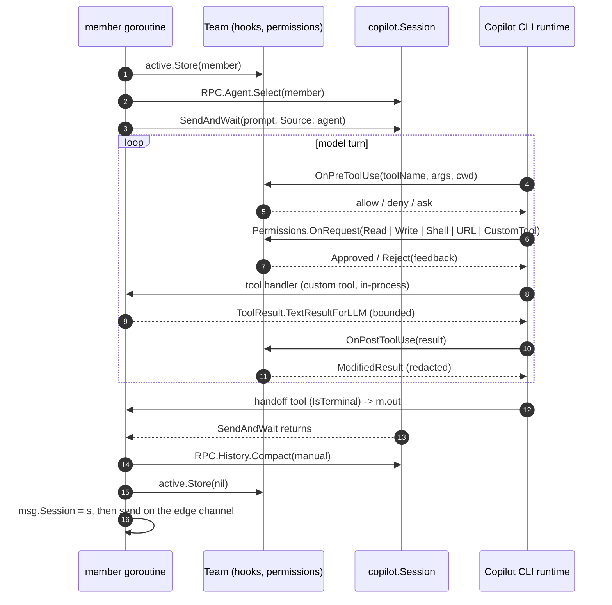
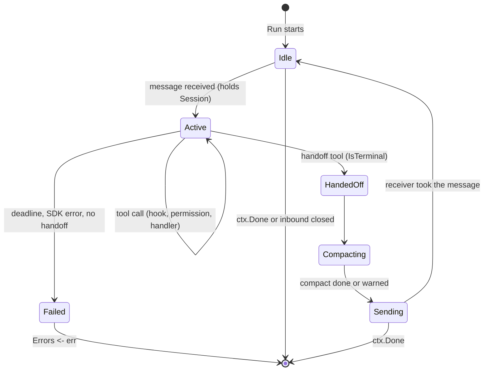
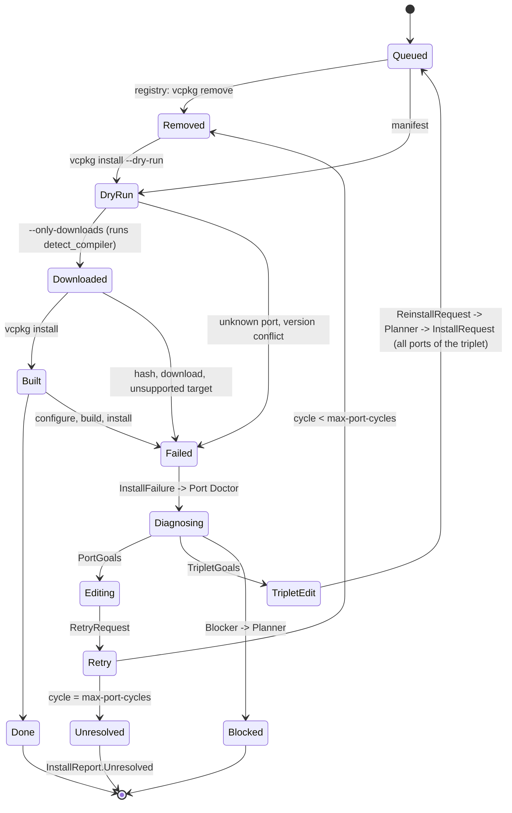
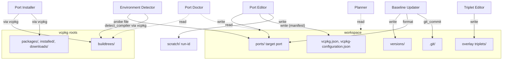
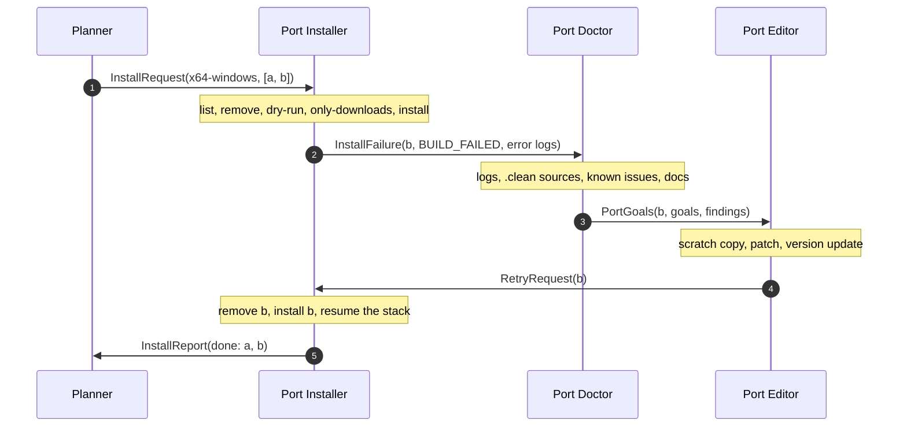
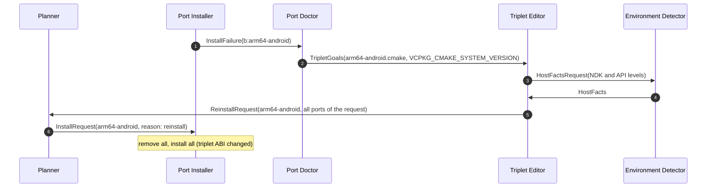
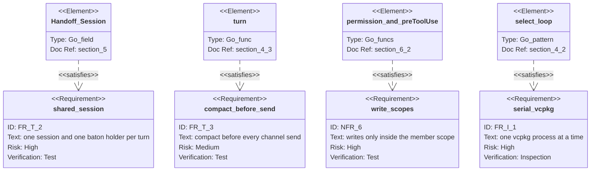

# vcpkg Agent Team: Specifications

| Item | Value |
|------|-------|
| Status | Draft 3 implementation, 2026-11-28 (unit, real vcpkg/Git, and live SDK verified) |
| Architecture source | [vcpkg-agents-ideation.md](./vcpkg-agents-ideation.md) (fixed) |
| Requirements | [vcpkg-agents-requirements.md](./vcpkg-agents-requirements.md) (user stories, FR/NFR, gaps G-1..G-26) |
| Facts and tests | [vcpkg-agents-research.md](./vcpkg-agents-research.md) (cited as Research §n) |
| Style reference | [vcpkg-agents.go](./vcpkg-agents.go) (style only) |
| Implementation | [vcpkg-agents.go](./vcpkg-agents.go), [vcpkg-agents_test.go](./vcpkg-agents_test.go) |
| SDK | `github.com/microsoft/copilot-sdk/go/v2` v2.0.4; Copilot CLI 1.0.114, protocol 4; model default `gpt-6-luna` |

This document maps the ideation onto Go and the Copilot SDK. It adds no member and no relationship. **Gap-fill G-n** marks a detail the ideation leaves open. The Go patterns in sections 4 and 6 were compiled against SDK v2.0.4 (`go vet`, `go run`, 2026-11-28); excerpts omit bodies marked by comments.

## 1. Architecture

One Go process. Seven members, one goroutine each. One channel per ideation edge. One Copilot session. Exactly one member takes a turn at a time.



Orange members have write scopes. The dashed edge is not in the ideation; it only locates gap G-1.

## 2. Process Model

### 2.1 Startup

Deterministic, no model. `main` calls `LoadRuntimeConfig` after flag parsing; results stay in one `RuntimeConfig` rather than package globals.

1. Parse flags (§2.3). Set up `log/slog`.
2. `exec.LookPath` for vcpkg, git, gh, cmake, ninja, shells. Copilot CLI from `COPILOT_CLI_PATH`; record its version (protocol must match the SDK, Research §5.1).
3. Classify `VCPKG_*` variable names (§9). Never store secret values.
4. `git rev-parse --show-toplevel`.
5. `vcpkg z-print-config` with designated roots and `--x-manifest-root`. No lock, no writes. Gives `buildtrees`, `downloads`, `installed`, `packages`, `vcpkg-root`, `default-triplet`, `host-triplet`, `manifest-mode-enabled`.
6. Detect the scenario (§3). Resolve member scopes (§6.3).

### 2.2 `main`

1. `copilot.NewClient(&copilot.ClientOptions{Mode: copilot.ModeCodingAgent, Runtime: copilot.SpawnedStdioConnection{Path, Env}})`.
2. `client.CreateSession(ctx, sessionOptions(...))` (§6.1).
3. `wire(...)` (§4.4): create edges, start goroutines, send `UserRequest`, wait for `FinalReport` or the first error, cancel, wait, close `Errors`.

Exit code is non-zero if `Errors` carried anything. Runs are non-interactive (**Gap-fill G-22**). No resume in v1 (**Gap-fill G-24**): rerun; binary caching restores finished ports.

### 2.3 CLI Flags

| Flag | Meaning | Source |
|------|---------|--------|
| `--prompt` (required), `--verbose`, `--model` | request, DEBUG logs, single model (FR-T-8) | draft |
| `--overlay-ports`, `--overlay-triplets` | explicit overlays, repeatable | Ideation §registry |
| `--x-buildtrees-root`, `--x-packages-root`, `--x-install-root`, `--x-manifest-root` | passed to every vcpkg call | Ideation §Environment Detector, §manifest |
| `--write` | scopes: `ports`, `triplets`, `versions`, `manifest`, `overlays`, `create-overlays`, `commit`; default by scenario (§6.3) | **Gap-fill G-6** |
| `--max-port-cycles` (3), `--max-triplet-edits` (1) | failure limits | **Gap-fill G-10** |
| `--lock-wait` (10m) | budget for a vcpkg lock held by another process | **Gap-fill G-19** |
| `--sandbox` | enable the OS sandbox layer (§6.2 L0); off until verified live | this draft |

## 3. Scenario Detection

**Gap-fill G-5.** Reuse vcpkg's own discovery so the team and vcpkg agree.

| Order | Evidence | Scenario |
|-------|----------|----------|
| 1 | `z-print-config` says `"manifest-mode-enabled": true` | manifest |
| 2 | git root or working directory has `ports/` and `versions/baseline.json` | registry; installs run in classic mode with explicit overlays (**Gap-fill G-26**) |
| 3 | neither | registry, classic mode; Planner reports the missing layout |

Hybrid workspaces follow the working directory (this repository: root is a registry, `test/` is a manifest). Log the decision, the evidence, and the losing candidate at INFO.

## 4. Concurrency Model

### 4.1 Rules

1. One goroutine per member. One `chan T` per ideation edge, typed by its message (§5).
2. Every channel has exactly one writer. The writer closes it with `defer` when its `Run` returns. Readers treat `!ok` as shutdown.
3. The channel a message arrives on identifies the sender. Messages carry no `From` field.
4. Receivers loop on one `select` over all inbound channels plus `ctx.Done()`. Sends also `select` on `ctx.Done()` (`send` helper).
5. The baton is `Handoff.Session`. The goroutine that holds a message holds the session. Only it calls `SendAndWait` (FR-T-2). Every other goroutine sits in `select`.
6. All channels are unbuffered except `InstallRequest` (`maxQueuedInstalls`, 16). Reason: the Planner queues one request per triplet (Ideation §Planner -> Port Installer) while the Installer is busy; without a buffer the Planner blocks and cannot receive a `Blocker` from the same cycle.
7. Shutdown is `ctx` cancellation, not channel close. The Installer → Doctor → Editor → Installer cycle cannot drain by close alone.
8. The vcpkg lock is respected by construction: rule 5 means one member runs, and only the Port Installer and Environment Detector start vcpkg.

Deadlock argument: with rule 5, at most one goroutine sends at any moment and every other goroutine is in `select` on its inbound channels, so every unbuffered send has a ready receiver. The one exception (Planner sending several `InstallRequest`s in one turn) is covered by rule 6.

### 4.2 Member Loop Pattern

Planner: one `select`, one case per inbound edge. Outputs close on return.

```go
func (p *Planner) Run(ctx context.Context, team *Team, e *Edges) {
	defer close(e.DetectRequest)
	defer close(e.InstallRequest)
	defer close(e.BaselineRequest)
	defer close(e.FinalReport)
	for {
		select {
		case <-ctx.Done():
			return
		case m, ok := <-e.UserRequest:
			if !ok {
				return
			}
			req, err := turn[DetectRequest](ctx, team, p.Member, m.Session, m.Prompt)
			if err != nil {
				e.Errors <- err
				return
			}
			req.Session = m.Session
			if send(ctx, e.DetectRequest, req) != nil {
				return
			}
		case m, ok := <-e.EnvReport:      // plan: one InstallRequest per triplet, in order
		case m, ok := <-e.InstallReport:  // judge: FinalReport, or BaselineRequest (registry)
		case m, ok := <-e.Blocker:        // judge: blocked, or continue with the rest
		case m, ok := <-e.ReinstallRequest: // reschedule the affected requests (FR-P-6)
		case m, ok := <-e.BaselineReport: // FinalReport with commits
		}
	}
}
```

Port Installer: a stack and a `waiting` flag. The stack runs only while no `InstallFailure` is outstanding.

```go
type Installer struct {
	*Member
	stack   []InstallRequest // arrival order (G-11)
	waiting bool             // an InstallFailure is out; the stack pauses
}

func (i *Installer) Run(ctx context.Context, team *Team, e *Edges) {
	defer close(e.InstallFailure)
	defer close(e.InstallReport)
	for {
		select {
		case <-ctx.Done():
			return
		case r, ok := <-e.InstallRequest:
			if !ok {
				return
			}
			i.stack = append(i.stack, r)
		case r, ok := <-e.RetryRequest:
			if !ok {
				return
			}
			i.waiting = false
			// reinstall r.Spec; a second failure sends InstallFailure again
		}
		for !i.waiting && len(i.stack) > 0 {
			if err := i.drain(ctx, team, e); err != nil { // head: install; pop on success, else InstallFailure + waiting
				e.Errors <- err
				return
			}
		}
	}
}
```

The other five members follow the Planner shape with their own inbound set (§7). Helper:

```go
func send[T any](ctx context.Context, ch chan<- T, m T) error {
	select {
	case ch <- m:
		return nil
	case <-ctx.Done():
		return ctx.Err()
	}
}
```

### 4.3 Turn and Handoff

One generic `turn` does steps 1 to 6 of the handoff protocol. The model ends its turn by calling a handoff tool; the tool handler drops the typed message into the member's `out` channel (capacity 1). `IsTerminal` ends the turn on success (Research §5.4).

```go
func handoffTool[T any](m *Member, name, description string) copilot.Tool {
	tool := copilot.DefineTool(name, description, func(msg T, inv copilot.ToolInvocation) (string, error) {
		select {
		case m.out <- msg:
			return "handoff accepted", nil
		default:
			return "", errors.New("error: this turn already handed off; do not call a second handoff tool")
		}
	})
	tool.IsTerminal = true
	return tool
}

func turn[T any](ctx context.Context, team *Team, m *Member, s *copilot.Session, prompt string) (T, error) {
	var zero T
	team.active.Store(m)                 // 1. hooks and permissions read this
	defer team.active.Store(nil)
	if _, err := s.RPC.Agent.Select(ctx, &rpc.AgentSelectRequest{Name: m.Name}); err != nil { // 2.
		return zero, fmt.Errorf("%s: select agent: %w", m.Name, err)
	}
	tctx, cancel := context.WithTimeout(ctx, m.Turn) // 3. explicit deadline; SendAndWait defaults to 60 s
	defer cancel()
	if _, err := s.SendAndWait(tctx, copilot.MessageOptions{
		Prompt: prompt,
		Source: copilot.MessageSourceAgent(m.Name),
	}); err != nil {
		return zero, fmt.Errorf("%s: turn: %w", m.Name, err)
	}
	var msg T
	select { // 4. the handoff tool ran, or the model stopped without one
	case v := <-m.out:
		var ok bool
		if msg, ok = v.(T); !ok {
			return zero, fmt.Errorf("%s: handed off %T, want %T", m.Name, v, zero)
		}
	default:
		return zero, fmt.Errorf("%s: turn ended without a handoff", m.Name)
	}
	trigger := rpc.SessionHistoryCompactRequestTriggerManual // 5. compact before the channel send (FR-T-3)
	instructions := "Keep: scenario, roots, write scopes, per-port state, open goals. Drop: tool output already summarized."
	if _, err := s.RPC.History.Compact(ctx, &rpc.SessionHistoryCompactRequest{
		Trigger: &trigger, CustomInstructions: &instructions,
	}); err != nil {
		team.log.Warn("compact failed", "agent", m.Name, "err", err)
	}
	return msg, nil // 6. caller sets msg.Session and sends on the edge
}
```

A member whose outbound set has several types (Doctor: `PortGoals`, `TripletGoals`, `Blocker`) calls `turn[any]` and switches on the dynamic type. Usage attribution: `s.RPC.Usage.GetMetrics` before and after; all usage lands under `main` (Research §5.1), the difference belongs to `m`.

Implementation detail: a `gpt-6-luna` turn that ends without the required terminal handoff gets one short retry. Deterministic handoffs (detection, installation reports, install plans, final reports, and limit blockers) are validated by Go and replaced with the already-computed payload after the model calls the terminal tool. This keeps the light model from changing paths, ports, triplets, commits, or limits.



### 4.4 Wiring and Shutdown

```go
func wire(ctx context.Context, team *Team, s *copilot.Session, prompt string) error {
	ctx, cancel := context.WithCancel(ctx) // ctx is the shutdown signal for every member
	defer cancel()
	e := newEdges()
	var wg sync.WaitGroup
	for _, run := range members(team) { // seven Run funcs
		wg.Add(1)
		go func() { defer wg.Done(); run(ctx, team, e) }()
	}
	e.UserRequest <- UserRequest{Handoff: Handoff{Session: s}, Prompt: prompt}
	close(e.UserRequest)
	var final FinalReport
	select {
	case final = <-e.FinalReport:
	case err := <-e.Errors:
		return err
	case <-ctx.Done():
		return ctx.Err()
	}
	cancel()
	wg.Wait()
	close(e.Errors)
	team.log.Info("final", "status", final.Status)
	return nil
}
```

`Errors` has capacity 64 so a member can report and return without a receiver. It is closed unused on success (Ideation §Implementation Styles).

### 4.5 State Machines

Member lifecycle (every member):



Port lifecycle inside one `InstallRequest`:



## 5. Messages

```go
// Handoff is embedded in every message. Session is the baton.
type Handoff struct {
	Session  *copilot.Session `json:"-"`
	Goal     string           `json:"goal" jsonschema:"What the receiver must achieve. Goals, not steps."`
	Evidence []string         `json:"evidence" jsonschema:"Log paths with lines, URLs, issue or pull request links."`
}
```

`copilot.DefineTool` derives the handoff tool schema from these structs (`json` and `jsonschema` tags). `Session` is excluded from the schema.

```mermaid
classDiagram
    class Handoff {
        +copilot.Session Session
        +string Goal
        +string[] Evidence
    }
    class UserRequest {
        +string Prompt
    }
    class DetectRequest {
        +string[] Triplets
    }
    class EnvReport {
        +string Scenario
        +string[] ScenarioEvidence
        +Roots Roots
        +string[] Overlays
        +TripletFile[] Triplets
        +ToolInfo[] Tools
        +VariableStatus[] Variables
        +FolderAccess[] Access
        +Web Web
        +PackageManager[] PackageManagers
        +Host Host
        +Compiler Compiler
        +string[] Warnings
        +string[] Blockers
    }
    class InstallRequest {
        +string Triplet
        +string[] Ports
        +string[] Features
        +string ManifestRoot
        +string Reason
    }
    class InstallReport {
        +Spec[] Done
        +Unresolved[] Unresolved
    }
    class InstallFailure {
        +Spec Spec
        +string Triplet
        +string Stage
        +int ExitCode
        +string ResultCode
        +string Command
        +string[] ErrorLogs
        +string IssueBody
        +string OutputLog
        +int Attempt
    }
    class PortGoals {
        +string Port
        +string[] Goals
        +Finding[] Diagnosis
        +NewPortGoal NewPort
    }
    class TripletGoals {
        +string TripletFile
        +string[] Variables
        +string Guidance
    }
    class Blocker {
        +Spec Spec
        +string Category
        +string Reason
        +Finding[] Findings
    }
    class RetryRequest {
        +Spec Spec
        +string[] Triplets
        +string[] ChangedFiles
    }
    class ReinstallRequest {
        +string Triplet
        +string TripletFile
        +string Change
        +string[] Ports
    }
    class HostFactsRequest {
        +string Question
    }
    class HostFacts {
        +string HostTriplet
        +string[] Compilers
        +string[] SDKs
        +string[] Notes
    }
    class BaselineRequest {
        +string[] Ports
    }
    class BaselineReport {
        +Commit[] Commits
        +string[] Skipped
    }
    class FinalReport {
        +string Status
        +LedgerEntry[] Ledger
        +Commit[] Commits
        +string[] Warnings
    }
    class Finding {
        +string Kind
        +string Text
        +string Source
    }
    Handoff <|-- UserRequest
    Handoff <|-- DetectRequest
    Handoff <|-- EnvReport
    Handoff <|-- InstallRequest
    Handoff <|-- InstallReport
    Handoff <|-- InstallFailure
    Handoff <|-- PortGoals
    Handoff <|-- TripletGoals
    Handoff <|-- Blocker
    Handoff <|-- RetryRequest
    Handoff <|-- ReinstallRequest
    Handoff <|-- HostFactsRequest
    Handoff <|-- HostFacts
    Handoff <|-- BaselineRequest
    Handoff <|-- BaselineReport
    Handoff <|-- FinalReport
    PortGoals o-- Finding
    Blocker o-- Finding
```



`Finding.Kind` is fact, observation, or interpretation. `InstallFailure.Stage` is dry-run, downloads, or build; `ResultCode` is vcpkg's `RESULTS` state (`BUILD_FAILED`, ...). `InstallRequest.Reason` is user or reinstall. Features (**Gap-fill G-7**) apply to the manifest scenario.

Edges (`type Edges struct`), one field per arrow in §1, plus `Errors chan error`. Request and reply pairs (`DetectRequest`/`EnvReport`, `HostFactsRequest`/`HostFacts`) are two plain channels, not a reply channel inside the message.

## 6. Harness

The harness is everything around the model: tool wrappers, hooks, permission policy, scopes, logs. Rules follow the sources in §6.5. The SDK already provides most of it; the team adds policy, not mechanism.

### 6.1 SDK Reuse

| Need | SDK type or call | Team adds |
|------|------------------|-----------|
| Member roles, tool allowlists | `copilot.CustomAgentConfig{Name, Prompt, Tools, Infer: copilot.Bool(false)}`; `session.RPC.Agent.Select` | prompt constants, allowlists (§7) |
| Custom tools, schema from structs | `copilot.DefineTool`, `copilot.Tool{IsTerminal, Idempotent, Exposure}`, `copilot.ToolResult`, `ToolInvocation.ReportProgress` | handlers |
| Pre-tool gate, cwd pin | `SessionHooks.OnPreToolUse` → `PreToolUseHookInput{ToolName, ToolArgs, WorkingDirectory}` → `PreToolUseHookOutput{PermissionDecision, ModifiedArgs}` | one function (`preToolUse`) |
| Parsed shell commands, paths, URLs | `rpc.PermissionRequestShell{Commands[].Identifier, Commands[].ReadOnly, PossiblePaths, HasWriteFileRedirection, PossibleURLs}`, `rpc.PermissionRequestRead{Path}`, `rpc.PermissionRequestWrite{FileName, Diff}`, `rpc.PermissionRequestURL{URL}` | one function (`permission`) that compares with scopes |
| Decisions | `rpc.PermissionDecisionApproved{}`, `rpc.PermissionDecisionReject{Feedback}` | none |
| Result redaction, failure context | `SessionHooks.OnPostToolUse{ModifiedResult}`, `OnPostToolUseFailure{AdditionalContext}` | redactor |
| OS sandbox (optional) | `SessionPermissionOptions.Sandbox: *rpc.SandboxConfig{Enabled, UserPolicy.Filesystem{ReadonlyPaths, ReadwritePaths, DeniedPaths}, UserPolicy.Network{AllowedHosts}}` | path lists from scopes |
| Large tool output | `SessionToolOptions.LargeOutput` | thresholds |
| Compaction | `session.RPC.History.Compact(&rpc.SessionHistoryCompactRequest{Trigger, CustomInstructions})` | call site in `turn` |
| Provenance | `copilot.MessageOptions.Source = copilot.MessageSourceAgent(name)` | none |
| Usage | `session.RPC.Usage.GetMetrics` | diff per turn |
| Working directory of built-in tools | `CreateSessionOptions.WorkingDirectory` | workspace root |
| Turn budget | `CustomAgentConfig.MaxToolTurns`, `MessageOptions.MaxToolTurns` | per member |

Not defined by the team: tool, message, hook, or permission interfaces of its own. Not used: `CustomAgentConfig.Hooks` (declarative, per agent, undocumented shape), `ResumeSession` (Research §5.6), `SkipPermission` on any tool.

### 6.2 Layers

| Layer | Mechanism | Enforces | Verified |
|-------|-----------|----------|----------|
| L0 OS sandbox | `rpc.SandboxConfig` (Windows AppContainer, macOS seatbelt, Linux) | file and network access of every child process, including vcpkg and builds | not yet; `--sandbox` off by default; experimental API |
| L1 tool visibility | `CustomAgentConfig.Tools` per member | a member cannot call a tool outside its list | live (Research §5.1) |
| L2 pre-tool hook | `OnPreToolUse` | no active member → deny; `cwd` outside member `Scope.CWD` → deny; shell tool for a member without `Scope.Shell` → deny; else `ask` | source |
| L3 permission | `Permissions.OnRequest` | read, write, shell, URL against `Scope`; custom tools approved (they enforce in Go) | source |
| L4 custom tool handler | Go code | argv from struct, `cmd.Dir = Scope.CWD`, scrubbed env, output to log file, bounded summary; vcpkg flags added by Go (§6.4) | live for the vcpkg commands (Research §8) |
| L5 post-tool hook | `OnPostToolUse`, `OnPostToolUseFailure` | redact secrets; add retry guidance on failure | source |
| L6 turn guard | `turn` | deadline, exactly one handoff, compaction, usage | live |
| L7 process | `init` checks, `Errors` channel, exit code | deterministic preconditions, fail fast | draft |

Hooks and permission requests carry no member identity (`AgentID` was empty in the live probe), so L2 and L3 read `team.active`. `ToolInvocation.AgentID` is experimental; if a later runtime fills it, compare it with `team.active` and deny on mismatch.

```go
func (t *Team) preToolUse(in copilot.PreToolUseHookInput, _ copilot.HookInvocation) (*copilot.PreToolUseHookOutput, error) {
	m := t.active.Load()
	if m == nil {
		return &copilot.PreToolUseHookOutput{PermissionDecision: "deny", PermissionDecisionReason: "no active member"}, nil
	}
	if in.WorkingDirectory != "" && !insideAny(in.WorkingDirectory, []string{m.Scope.CWD}) {
		return &copilot.PreToolUseHookOutput{PermissionDecision: "deny", PermissionDecisionReason: "working directory outside the member scope"}, nil
	}
	switch in.ToolName {
	case "bash", "powershell": // shell tool names as the runtime reports them; confirm in the first live run
		if m.Scope.Shell == nil {
			return &copilot.PreToolUseHookOutput{PermissionDecision: "deny", PermissionDecisionReason: m.Name + " has no shell"}, nil
		}
	}
	return &copilot.PreToolUseHookOutput{PermissionDecision: "ask"}, nil // the permission handler decides with parsed data
}

func (t *Team) permission(req copilot.PermissionRequest, _ copilot.PermissionInvocation) (rpc.PermissionDecision, error) {
	m := t.active.Load()
	if m == nil {
		return reject("no active member"), nil
	}
	switch r := req.(type) {
	case rpc.PermissionRequestRead:
		if insideAny(r.Path, m.Scope.Read) {
			return &rpc.PermissionDecisionApproved{}, nil
		}
		return reject("read outside scope: " + r.Path), nil
	case rpc.PermissionRequestWrite:
		if insideAny(r.FileName, m.Scope.Write) {
			return &rpc.PermissionDecisionApproved{}, nil
		}
		return reject("write outside scope: " + r.FileName), nil
	case rpc.PermissionRequestShell:
		for _, c := range r.Commands {
			if !contains(m.Scope.Shell, c.Identifier) {
				return reject("command not allowed: " + c.Identifier), nil
			}
		}
		if r.HasWriteFileRedirection && len(m.Scope.Write) == 0 {
			return reject("write redirection"), nil
		}
		for _, p := range r.PossiblePaths {
			if !insideAny(p, m.Scope.Read) {
				return reject("path outside scope: " + p), nil
			}
		}
		return &rpc.PermissionDecisionApproved{}, nil
	case rpc.PermissionRequestURL:
		if strings.HasPrefix(r.URL, "https://") {
			return &rpc.PermissionDecisionApproved{}, nil
		}
		return reject("only https"), nil
	case rpc.PermissionRequestCustomTool:
		return &rpc.PermissionDecisionApproved{}, nil // custom tools enforce their own scope in Go
	}
	return reject("unknown request kind"), nil
}
```

`reject` wraps `&rpc.PermissionDecisionReject{Feedback: &why}`; the feedback reaches the model, so it states the rule, never a secret.

### 6.3 Folder and Working Directory Scopes

```go
type Scope struct {
	CWD   string   // working directory of every process the member starts
	Read  []string // readable roots
	Write []string // writable roots; always a subset of Read
	Shell []string // allowed first words of shell commands; nil means no shell
}
```

`insideAny` resolves `filepath.Abs` and `filepath.EvalSymlinks` first, then `filepath.Rel` must not start with `..`. Junctions and symlinks therefore cannot escape a root. Paths with a different volume fail `Rel` and are denied.

Roots from `init`: `workspace` (git root), `manifestRoot`, `vcpkgRoot` (next to `vcpkg.exe`), `roots.{buildtrees,downloads,installed,packages}` (z-print-config), `overlays.{ports,triplets}` (flags, env, configuration), `registry.{ports,versions,triplets}` (registry scenario), `scratch` = `os.TempDir()/vcpkg-agents/<run-id>/`, `teamLogs` = `scratch/logs`.

| Member | CWD | Read | Write | Shell |
|--------|-----|------|-------|-------|
| Planner | workspace | workspace, vcpkg roots | none | nil |
| Environment Detector | workspace | workspace, vcpkg roots, tool folders | one probe file per planned write root (G-14), deleted after | version and path probes, package manager search |
| Port Installer | manifestRoot or workspace | workspace, vcpkg roots | none; vcpkg writes its roots itself | nil (vcpkg only through custom tools) |
| Port Doctor | workspace | workspace, vcpkg roots, buildtrees | none | `git log`, `git show`, `git diff` |
| Port Editor | workspace | workspace, vcpkg roots, scratch | target `ports/<port>/`; manifest scenario: `vcpkg.json`, `vcpkg-configuration.json`, existing overlay folders (G-7); scratch | `git diff`, `git status` |
| Triplet Editor | workspace | workspace, vcpkg roots | writable overlay triplet folders | nil |
| Baseline Updater | registry root | workspace | `ports/<port>/` (format only), `versions/`, `.git` through `git_commit` | registry scripts, `git add`, `git commit` |

Always denied for writes: `.git/` (except via `git_commit`), `vcpkgRoot/scripts`, the user home, anything outside `workspace`, `scratch`, and the vcpkg roots. `create-overlays` (new `ports/` or `triplets/` in the manifest scenario) is never a default (**Gap-fill G-6**).

Default `--write`: registry → `ports`, `triplets`, `versions`, `commit`; manifest → `manifest`, `overlays`.



### 6.4 CLI Command Harness

Two paths. Both end in a bounded summary for the model and a full log on disk.

1. Built-in shell tool (`bash` or `powershell`), only for members with `Scope.Shell`: L2 pins `cwd` and the member; L3 checks every parsed `Commands[].Identifier` against `Scope.Shell`, every `PossiblePaths` entry against `Scope.Read`, and rejects write redirection for members without `Scope.Write`. The runtime parses the command; Go never re-parses shell text.
2. Custom tools (`vcpkg_*`, `probe_tool`, `make_patch`, `version_update`, `git_commit`, `gh_read`): the model supplies a struct, Go builds argv. No shell. `probe_tool` accepts only the exact default read-only version arguments for that tool; it cannot accept an interpreter or shell program. Shape:

```go
func runVcpkg(ctx context.Context, m *Member, logDir string, args ...string) (string, error) {
	logPath := filepath.Join(logDir, fmt.Sprintf("vcpkg-%d.log", time.Now().UnixMilli()))
	f, err := os.Create(logPath)
	if err != nil {
		return "", err
	}
	defer f.Close()
	cmd := exec.CommandContext(ctx, "vcpkg", args...)
	cmd.Dir = m.Scope.CWD
	cmd.Env = scrubbedEnv()
	cmd.Stdout, cmd.Stderr = f, f
	err = cmd.Run()
	return fmt.Sprintf("exit=%v log=%s", cmd.ProcessState.ExitCode(), logPath), err
}
```

vcpkg rules applied by Go, not by the model:

1. `--triplet` on every call; `--host-triplet` when designated; overlays explicit (`--overlay-ports`, `--overlay-triplets`); designated roots on every call.
2. The summary returns only: exit code, duration, the dry-run plan, `RESULTS` states, `error: building <spec> failed with: <RESULT>` lines, paths from `buildtrees/<port>/error-logs-<triplet>.txt`, the `<installed>/vcpkg/issue_body.md` path, `info: loaded overlay triplet from here` / `info: installing overlay port from here` lines, binary cache warnings (Research §8.1, §8.2, §8.8).
3. `--x-wait-for-lock` on every locking command; the handler watches for `note: waiting to take filesystem lock...` and stops vcpkg after `--lock-wait` (**Gap-fill G-19**; Research §8.3).
4. `vcpkg_query` subcommand allowlist: `version`, `z-print-config`, `list`, `search`, `depend-info`, `x-package-info`, `help`. `detect_compiler` always adds `--dry-run` to `x-set-installed` (without it, vcpkg removes every other installed package).
5. Never `--debug`, `--debug-env`; probes pass `--disable-metrics`. Never run the `gh issue create` line vcpkg prints (FR-T-13); `gh_read` scans the full argument list, rejects GraphQL and any non-GET method (including repeated or conflicting methods), and rejects field/input upload flags.
6. On an argument error the member runs `vcpkg_help` and retries (FR-T-5).

Tool set (member column is the `CustomAgentConfig.Tools` allowlist):

| Tool | Members | Side effects | Guard |
|------|---------|--------------|-------|
| `view`, `glob`, `rg` (built-in) | all | none | L3 read scope |
| `edit`, `create`, `apply_patch` (built-in) | Port Editor, Triplet Editor, Baseline Updater | file writes | L3 write scope |
| `web_fetch` (built-in) | Port Doctor, Port Editor, Triplet Editor | network | https only |
| shell (built-in) | members with `Scope.Shell` | per command | L2, L3 |
| `vcpkg_help` | all | none | topic is one word |
| `vcpkg_query` | Environment Detector, Port Installer, Port Doctor | none | allowlist above |
| `vcpkg_install` | Port Installer | vcpkg roots | stage flag required (`dry-run`, `only-downloads`, `build`) |
| `vcpkg_remove` | Port Installer | vcpkg roots | registry scenario only (G-12) |
| `read_log` | Port Installer, Port Doctor | none | path inside a vcpkg root; bounded tail and matches |
| `probe_tool`, `detect_compiler` | Environment Detector | none; vcpkg `buildtrees` | allowlist; forced `--dry-run` |
| `gh_read` | Port Doctor, Port Editor, Environment Detector | network | read-only subcommands |
| `vcpkg_create`, `make_patch`, `download_sha512` | Port Editor | port folder, scratch, network | target inside write scope; https |
| `version_update`, `git_commit` | Baseline Updater | `ports/<port>/vcpkg.json`, `versions/`, git | paths limited to `ports/<port>/` or `versions/` |
| MCP `microsoft-learn`; enterprise MCP (optional) | Port Doctor, Triplet Editor; Port Doctor | network | read-only |
| handoff tools (`send_*`) | one set per member | `m.out` | `IsTerminal`; schema validation |

### 6.5 Harness Engineering Sources

| Source | Applied here |
|--------|--------------|
| OpenAI, "Harness engineering: leveraging Codex in an agent-first world" (R. Lopopolo, 2026-02-11), https://openai.com/index/harness-engineering/ | enforce invariants mechanically, not by instruction: L2–L4 gates; short role prompts that point to evidence, not manuals (§4.4 prompt rules) |
| B. Böckeler, "Harness engineering for coding agent users" (martinfowler.com, 2026-04-02), https://martinfowler.com/articles/harness-engineering.html | feedforward guides (prompts, tool descriptions) vs feedback sensors (vcpkg exit codes, logs, tree guard); deterministic checks first, model judgment second |
| LangChain, "The Anatomy of an Agent Harness" (V. Trivedy, 2026-03-10), https://www.langchain.com/blog/the-anatomy-of-an-agent-harness | "Agent = Model + Harness"; hooks as deterministic middleware: compaction in `turn`, gates in hooks |
| Anthropic, "Writing effective tools for AI agents" (2025-09-11), https://www.anthropic.com/engineering/writing-tools-for-agents | tools as a contract between deterministic code and the model: struct parameters, bounded token-efficient results, `TextResultForLLM` always set |
| Anthropic, "Effective context engineering for AI agents" (2025-09-29), https://www.anthropic.com/engineering/effective-context-engineering-for-ai-agents | compaction with custom instructions; self-contained messages so compaction loses nothing (NFR-3) |
| Anthropic, "Effective harnesses for long-running agents" (2025-11-26), https://www.anthropic.com/engineering/effective-harnesses-for-long-running-agents | compaction is not enough: per-port state and ledger live in Go, artifacts on disk (logs, patches, commits) |
| Anthropic, "Scaling Managed Agents with stable interfaces" (2026-04-08), https://www.anthropic.com/engineering/managed-agents | brain/hands split: the model decides, Go executes (`execute(name, input) → string`) |
| Yang et al., "SWE-agent: Agent-Computer Interfaces Enable Automated Software Engineering" (arXiv 2405.15793, 2024) | purpose-built interfaces (`read_log`, `vcpkg_install` stages) beat raw shells |
| Copilot SDK docs: hooks overview, pre-tool-use, post-tool-use, context management, custom agents (github.com/microsoft/copilot-sdk/docs) | `permissionDecision` allow/deny/ask; cwd allowlist example; `isTerminal` ends a turn only on success; audit by `(sessionId, toolCallId)` |

## 7. Members

Format: inputs → outputs; tools; behavior as goals and checks (FR-T-4). Scopes are in §6.3.

### 7.1 Planner

- In: `UserRequest`, `EnvReport`, `InstallReport`, `Blocker`, `ReinstallRequest`, `BaselineReport`. Out: `DetectRequest`, `InstallRequest` (one per triplet, in order), `BaselineRequest`, `FinalReport`.
- Tools: `view`, `glob`, `rg`, `vcpkg_help`, handoff tools. No writes (FR-P-5).
- Delegate detection first (FR-P-2). Turn the request into ordered requests per triplet. A report that meets the user's goals → `finished`; a blocker that removes every remaining path → `blocked`. Registry scenario, after success: `BaselineRequest` for changed, verified ports (FR-P-7). On `ReinstallRequest`: reschedule the affected requests (FR-P-6).

### 7.2 Environment Detector

- In: `DetectRequest`, `HostFactsRequest`. Out: `EnvReport`, `HostFacts`.
- Tools: `probe_tool`, `detect_compiler`, `vcpkg_query`, `vcpkg_help`, `gh_read` (auth, rate limit), `view`, `glob`. No file writes except probe files (FR-E-5).
- Procedure, identical to startup (FR-E-10):
  1. Tool paths and versions: vcpkg, git, gh, cmake, ninja, shells, curl, tar, meson, pkg-config, zip, unzip, python, compilers, package managers.
  2. Roots and triplets from `z-print-config`; overlays from flags, `VCPKG_OVERLAY_*`, `vcpkg-configuration.json`; the winning triplet file per requested triplet (overlay → `triplets/` → `triplets/community/`).
  3. `VCPKG_*` names and status (§9).
  4. Folder access (**Gap-fill G-14**): read everywhere planned; write by one uniquely named probe file in planned write roots and vcpkg roots; binary cache folders checked directly, since dry runs do not validate them (Research §8.6).
  5. Web: `gh api rate_limit`, Microsoft Learn.
  6. Compiler facts: `detect_compiler` → `buildtrees/detect_compiler/stdout-<triplet>.log` (`#COMPILER_C_ID#`, `#COMPILER_C_VERSION#`, `#COMPILER_C_PATH#`, CXX equivalents). Failure means the host cannot build the triplet (Research §8.5).
  7. Manifest scenario: triplets and features used by CI from `CMakePresets.json`, `CMakeUserPresets.json`, `CMakeLists.txt`, `CMakeSettings.json`, workflows (Research §7.4, §7.5).
  8. vcpkg clone state: shallow, HEAD, distance behind upstream; manifest: each baseline commit present (Research §6.6, §7.3).
  9. Registry scenario, git preconditions for version commands: file system records ownership, vcpkg's git opens the repository, `core.autocrlf`, `.gitattributes`, port files LF (Research §8.10).

### 7.3 Port Installer

- In: `InstallRequest` (buffered), `RetryRequest`. Out: `InstallFailure`, `InstallReport`.
- Tools: `vcpkg_query` (`list`), `vcpkg_remove`, `vcpkg_install`, `read_log`, `vcpkg_help`, handoff tools. No direct file creation (FR-I-9).
- Per request (states in §4.5): `list`; registry: `remove` the requested ports (`--recurse` when dependents exist; classic mode never rebuilds an installed port, Research §8.1); `--dry-run` (classic dry runs skip compiler detection); `--only-downloads` (sources, compiler detection, catches unsupported targets, Research §8.5, §8.8); `install`; on failure read `error-logs-<triplet>.txt` and `issue_body.md`.
- Manifest scenario: same stages without port arguments, with `--x-manifest-root` and `--x-feature`; no `remove` (vcpkg rejects it and rebuilds changed ports itself, G-12; Research §8.4).
- Stack (**Gap-fill G-11**): arrival order; a retry runs before the rest. Limits (**Gap-fill G-10**): after `--max-port-cycles` failed cycles the port is unresolved and the stack continues.

### 7.4 Port Doctor

- In: `InstallFailure`. Out: `PortGoals`, `TripletGoals`, `Blocker`.
- Tools: `view`, `glob`, `rg`, `read_log`, `vcpkg_query`, `vcpkg_help`, `gh_read`, `web_fetch`, MCP `microsoft-learn`, optional enterprise MCP. No writes.
- Find the failed stage, then the axis (build configuration, toolchain, installation, misc; Research §6.2, §6.3). `error-logs-<t>.txt` never lists patch, download, hash, or post-build failures: read `stdout-<t>.log` and `patch-<t>-*-err.log` too.
- Staleness: compare the port with upstream history (`gh api "repos/microsoft/vcpkg/commits?path=ports/<port>&since=<baseline date>"`); the clone may be shallow and behind (Research §6.6).
- Known issues in this order: `scripts/ci.baseline.txt`, issues `<port> in:title`, exact signature phrase, merged pull requests, Discussions. A closed issue counts as fixed only with `stateReason: COMPLETED` or a closing pull request (Research §6.5).
- Findings are facts, observations, interpretations, each with a source. Goals let the Port Installer start with confidence: a hash mismatch needs a provenance check before a new `SHA512`; a post-build warning maps to the helper the message names, not to `VCPKG_POLICY_*`.
- Routing (**Gap-fill G-8**): port files, new port, or manifest `vcpkg.json` writable → Port Editor; triplet writable → Triplet Editor; target not writable, unsupported host, or missing SDK → Planner (`Blocker`).

### 7.5 Port Editor

- In: `PortGoals` (and `UpdateGoal` if G-1 adds that edge). Out: `RetryRequest`.
- Tools: `view`, `glob`, `rg`, `edit`, `create`, `apply_patch`, `vcpkg_create`, `make_patch`, `download_sha512`, `gh_read`, `web_fetch`, `vcpkg_help`, handoff tools.
- Manifest edits follow vcpkg rules (Research §7.1, §7.2): strict JSON; baseline change to upgrade in general, `version>=` for one port, `overrides` for an exact pin; never `builtin-baseline` next to a configuration-file `default-registry`; never `.` as an overlay path.
- Patch workflow (**Gap-fill G-9**, verified in Research §8.9): copy `buildtrees/<port>/src/<name>.clean` to scratch; `make_patch` does `git init`, `git add -A`, baseline commit; edit the copy; `make_patch` runs `git diff --output=<file>` into `ports/<port>/<name>.patch` with `-c core.autocrlf=false` and `GIT_CONFIG_NOSYSTEM=1`, no shell pipe; verify on a fresh `.clean` copy with vcpkg's own `git apply` line; append to `PATCHES`; delete scratch. No untracked file may stay in the port folder (`x-add-version` hashes untracked files).
- Repository tips (**Gap-fill G-17**): follow the workspace's guides and existing patch conventions; start each patch with a header stating why and the upstream issue or pull request.
- Versions: bump `version` or `port-version` per vcpkg rules; leave them if `git diff` shows they already changed (FR-PE-5).
- New port: `vcpkg create <name> <url> --x-builtin-ports-root=<target ports folder>`; replace the template's `vcpkg_download_distfile` and deprecated `vcpkg_extract_source_archive_ex` (Research §8.7); complete configure, install, config fixup, copyright, usage.

### 7.6 Triplet Editor

- In: `TripletGoals`, `HostFacts`. Out: `ReinstallRequest`, `HostFactsRequest`.
- Tools: `view`, `glob`, `rg`, `edit`, `create`, `web_fetch`, MCP `microsoft-learn`, `vcpkg_help` (`triplet`), handoff tools.
- Read the triplet in use and the official variables; evaluate candidates; apply one change; state its effect. A built-in triplet is changed by creating an overlay copy (US-7.3). Every change alters `triplet_abi` and invalidates cached binaries for that triplet, so the Port Installer rebuilds every port of it. Limit: `--max-triplet-edits` per triplet (**Gap-fill G-10**).

### 7.7 Baseline Updater

- In: `BaselineRequest` (registry only). Out: `BaselineReport`.
- Tools: `version_update`, `git_commit`, `view`, `vcpkg_help`, handoff tools.
- Per port, 2 commits (FR-B-2): call `version_update(stage: "format")`, commit `ports/<port>/`, call `version_update(stage: "versions")`, then commit `versions/`. Overlay flags are not passed to `x-add-version`. For a new record, Go creates `{"versions":[]}` and uses `--overwrite-version`; existing records never receive that flag.
- Order (**Gap-fill G-16**): dependencies first; ties follow the order the team changed the ports.
- `--overwrite-version` (**Gap-fill G-21**): only for an entry not yet on the base branch; otherwise report the port as blocked ("`port-version` not bumped"; see G-1).
- Tree guard: before the version commit, and again in `validateBaselineReport`, recorded `git-tree` must equal `git rev-parse <port commit>:ports/<port>`. A mismatch blocks the handoff and leaves no version commit. The validator also checks actual changed paths and port-before-versions commit ancestry. `x-ci-verify-versions` is not used (false errors for upstream ports).

## 8. Flows

Port cycle (US-2.2):



Triplet path (US-2.4):



Failure paths:

| Failure | Detected by | Next | Limit |
|---------|-------------|------|-------|
| Unknown port, version conflict | dry run | Port Doctor | port cycle |
| Download or hash mismatch | `--only-downloads` | Port Doctor → Port Editor | port cycle |
| Configure, build, install error | install | Port Doctor | port cycle |
| Triplet cause | Port Doctor | Triplet Editor → Planner | `--max-triplet-edits` |
| Unsupported host or target, missing SDK | `--only-downloads`, Environment Detector, Port Doctor | Planner (`Blocker`) | none |
| Binary cache warning | Port Installer | log, continue (FR-T-11) | none |
| Lock held by another vcpkg | Port Installer | wait (`--x-wait-for-lock`), then `Blocker` | `--lock-wait` |
| Turn without handoff, deadline, SDK error | `turn` | `Errors`, process exits | none |

## 9. Environment Variables and Secrets

**Gap-fill G-13.** Facts and the full table: Research §4, §8.6.

- Startup and the Environment Detector record each `VCPKG_*` and `X_VCPKG_*` name with a status (set, path exists, writable, parse result). Values are shown only for roots, triplets, overlays, flags.
- Never logged or sent to the session: `VCPKG_BINARY_SOURCES`, `X_VCPKG_ASSET_SOURCES`, NuGet settings, `X_VCPKG_RECURSIVE_DATA`, proxy credentials, any name or value matching `TOKEN`, `KEY`, `SECRET`, `sig=`, `AccessKey`. Report structure only (provider, host, mode, SAS expiry).
- Lint binary and asset sources before vcpkg sees them: a vcpkg parse error echoes the whole value (Research §4.6).
- `scrubbedEnv()` keeps system variables, every variable vcpkg reads, proxies, and `VCPKG_KEEP_ENV_VARS` names; drops secrets vcpkg does not read (`GITHUB_TOKEN`, custom `VCPKG_`-prefixed credentials). Linux and macOS pass the full environment into builds, so this matters most there (Research §4.3).
- Fatal conditions reported as blockers: empty `VCPKG_DEFAULT_TRIPLET` or `VCPKG_DOWNLOADS`; missing `VCPKG_DEFAULT_BINARY_CACHE` folder; invalid `VCPKG_MAX_CONCURRENCY` or `X_VCPKG_REGISTRIES_CACHE`. Warnings: mismatched `VCPKG_ROOT`, `VCPKG_KEEP_ENV_VARS` (untracked build input), `x-gha` provider, missing binary cache folders.
- `OnPostToolUse` redacts tool results (L5).

## 10. Logging

`log/slog` text handler; INFO default, DEBUG with `--verbose`. Keys: `agent`, `session`, `message`, `tool`, `args` (redacted), `path`, `exit`, `duration`. INFO: scenario decision, every handoff (edge, type), every write approval, every vcpkg call, compaction start and end, usage per member. DEBUG: tool arguments, hook decisions, read approvals. Audit correlation by `(SessionID, ToolCallID)` as the SDK hook docs recommend.

## 11. Coding Style

From the draft, unchanged: one file, `package main`; prompts as constants; `init` runs `Check...` functions and logs each; `New<Member>` + `Run(ctx, team, edges)`; tool parameters are structs with `json` and `jsonschema` tags; tool handlers return `"error: %v\n%s"` text so the model can read failures; path checks through `insideAny`; `context.WithTimeout` per call. SDK v2 groups session options (`CreateSessionOptions{Tools, Agents, Permissions, Hooks, WorkingDirectory}`) where v1 used a flat config.

## 12. Traceability

IDs map to the requirements document: `FR_T_2` is FR-T-2, `NFR_6` is NFR-6, `FR_I_1` is FR-I-1 (the diagram grammar rejects hyphens and commas).



## 13. Open Items

- G-1 (critical, user decision): how update requests reach the Port Editor. Recommended Planner → Port Doctor; not adopted (adds an edge).
- Open: G-20, G-23. Pending confirmation: G-6 to G-11, G-14 to G-17, G-19, G-21, G-22, G-24, G-26 (requirements §9).
- Implemented and live-verified for registry dry runs: one `gpt-6-luna` session, five terminal handoffs for the simple scenario, and no port installation.
- Still unverified: `rpc.SandboxConfig` on Windows (AppContainer) with vcpkg child processes. G-1 update stories remain blocked rather than adding an architecture edge.
